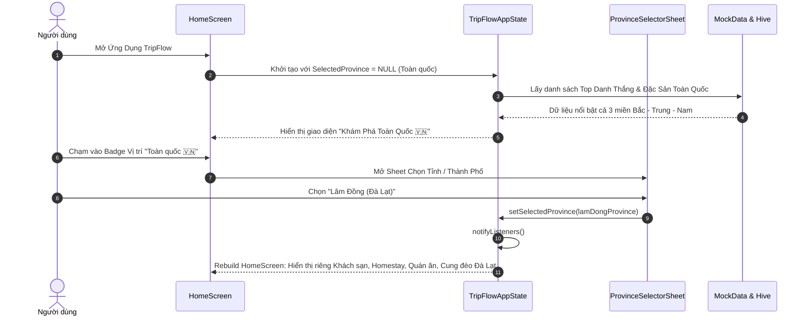

# 📋 KẾ HOẠCH NÂNG CẤP TOÀN DIỆN TRIPFLOW THÀNH SUPER APP DU LỊCH & PHƯỢT SỐ 1 VIỆT NAM

**Dự án:** TripFlow — Super App Khám Phá, Đặt Dịch Vụ & Lộ Trình Phượt Thông Minh  
**Tác nhân thực hiện:** 🧠 Planner Agent (Agent 1)  
**Người nhận kế hoạch:** 💻 Coder Agent (Agent 2)  
**Ngày lập kế hoạch:** 05/11/2026  
**Mục tiêu chính:** Tái cấu trúc ứng dụng di động Flutter và hệ thống backend thành một **Super App Du Lịch Hoàn Chỉnh**, xóa bỏ mặc định TP.HCM, định hình bộ nhận diện thương hiệu đẳng cấp Anti-AI-Slop, tích hợp 5 dịch vụ cốt lõi (Đặt phòng, Đặt vé xe/tàu/bay, Tour phượt trải nghiệm, Dữ liệu quán ăn cào thực tế từ internet, Lập lịch trình phượt đa ngày theo phương tiện kèm Biker Corridor Search).

---

## 1. TỔNG QUAN & MỤC TIÊU PHÁT TRIỂN

### 1.1. Hiện trạng Codebase & Những điểm cần khắc phục
1. **Thiên vị cục bộ (Local Bias):** Trạng thái ứng dụng hiện tại gán mặc định `ProvinceModel _selectedProvince = MockDataRepository.provinces.first;` (TP. Hồ Chí Minh). Người dùng mở ứng dụng chỉ thấy dữ liệu TP.HCM, không thấy bức tranh du lịch tổng thể của Việt Nam và không rõ cách chuyển sang chế độ Toàn quốc.
2. **Giao diện rập khuôn AI-Slop (Generic Cliché Header):** Header hiện tại dùng lời chào *"Xin chào, Du khách 👋"* và *"Đi Đâu Tiếp Theo?"*, mang tính hình thức, thiếu chiều sâu thương hiệu và không định vị được TripFlow là nền tảng du lịch số 1 Việt Nam.
3. **Thiếu vắng hệ sinh thái dịch vụ Super App:** Ứng dụng hiện chỉ tập trung vào việc đọc danh mục địa điểm và món ăn tĩnh, chưa có các dịch vụ thiết yếu giúp du khách đặt phòng khách sạn/homestay, đặt vé xe khách/tàu hoả/máy bay, hay book các tour trải nghiệm mạo hiểm.
4. **Dữ liệu quán ăn chưa đầy đủ thông tin thực tế:** Dữ liệu nhà hàng hiện tại thiếu số hotline đặt bàn, giờ mở cửa chi tiết, bảng giá món ăn cụ thể từ internet và trải nghiệm xem menu trực quan.
5. **Công cụ lập lịch trình phượt chưa tối ưu cho Biker / Road-trip:** Wizard lập lịch trình chưa làm nổi bật các gói thời gian phượt điển hình (1 ngày, 2N1Đ, 3N2Đ, Xuyên Việt), chưa hỗ trợ sâu cho xe máy đi phượt (tìm trạm xăng, quán sửa xe máy ven đường, đèo ngắm cảnh, quán nước ven đường) và ô tô tự lái (trạm dừng nghỉ cao tốc, trạm sạc điện EV).

### 1.2. Mục tiêu Nâng cấp Đột phá (5 Trụ cột Super App)
1. **Chế độ Vị trí Kép (National First & Province Flexible):**
   - Mặc định khởi động ở chế độ **"Toàn quốc 🇻🇳 — Khám Phá Việt Nam"**.
   - Hiển thị danh thắng tiêu biểu, đặc sản trứ danh và các cung đường huyền thoại từ Bắc vào Nam (Hà Nội, Vịnh Hạ Long, Sa Pa, Tràng An Ninh Bình, Cố đô Huế, Phố cổ Hội An, Đà Nẵng, Nha Trang, Đà Lạt, TP.HCM, Phú Quốc,...).
   - Hỗ trợ đổi sang tỉnh thành bất kỳ bằng BottomSheet chọn tỉnh trực quan, có tìm kiếm và phân vùng (Bắc Bộ, Trung Bộ, Tây Nguyên, Nam Bộ).
2. **Brand Identity Hero Header (Chuẩn Anti-AI-Slop):**
   - Thiết kế trang nhã, tương phản cao trên nền tone Slate / Cream ấm áp.
   - Logo thương hiệu `TRIPFLOW`, Tagline `Nền Tảng Du Lịch & Phượt Thông Minh #1 Việt Nam`.
   - Tiêu đề truyền cảm hứng: `Hành Trình Bất Tận, Trải Nghiệm Đỉnh Cao`.
   - Các chỉ số uy tín (Trust Badges): `63 Tỉnh/Thành` • `1.200+ Điểm đến thực tế` • `100% Dữ liệu xác minh`.
3. **Hub Dịch Vụ Du Lịch Toàn Diện (Super App Service Grid):**
   - 🏨 **Khách Sạn & Homestay (Hotel & Stay Booking):** Tìm & đặt resort, homestay săn mây view đẹp, villa, khách sạn 3-5 sao, xem tiện nghi, bảng giá, đặt phòng nhận mã E-Voucher.
   - 🎫 **Vé Xe, Tàu & Máy Bay (Transport Ticket Booking):** Đặt xe khách Limousine giường nằm, tàu hoả Bắc Nam, vé máy bay nội địa theo tuyến và giờ đi.
   - 🗺️ **Tour & Trải Nghiệm Tuyển Chọn (Curated Trips & Adventure Tours):** Tour trekking leo núi (Fansipan, Tà Năng Phan Dũng), phượt xe máy Mã Pí Lèng Hà Giang Loop, tour lặn san hô Phú Quốc, food tour phố cổ.
   - 🍜 **Ẩm Thực & Quán Ngon Cào Thực Tế Từ Internet:** Dữ liệu cào Google Maps / mạng xã hội: Địa chỉ số nhà chính xác, hotline thật, khung giờ mở cửa, bảng giá món ăn rõ ràng, nút gọi điện thoại & chỉ đường tức thì.
   - 🏍️ **Lập Lịch Trình Phượt & Corridor Search Chuyên Sâu:** Thiết kế hành trình theo số ngày (1 ngày, 2N1Đ, 3N2Đ, Xuyên Việt), phân loại phương tiện (Xe máy phượt, Ô tô tự lái, Xe khách), tích hợp thuật toán Bounding Box / Corridor Search quét các trạm xăng, quán sửa xe, quán cà phê ngắm đèo và điểm check-in dọc đường.

---

## 2. KIẾN TRÚC HỆ THỐNG & DATA FLOW

### 2.1. Sơ đồ Kiến trúc Tổng thể (Clean Architecture)

```mermaid
flowchart TD
    subgraph UI Layer (Flutter Presentation)
        A[HomeScreen] --> B[BrandIdentityHeader]
        A --> C[SuperAppServiceGrid]
        A --> D[HeroTripCarousel]
        A --> E[PopularDestinationSection]
        A --> F[InternetScrapedFoodsSection]
        
        C --> G1[HotelsScreen / HotelDetailScreen]
        C --> G2[TransportScreen / ETicketDialog]
        C --> G3[ToursScreen / TourDetailScreen]
        C --> G4[PlannerWizardScreen / RoadtripCorridorScreen]
        C --> G5[RestaurantsScreen / FoodDetailScreen]
    end

    subgraph State & Business Logic
        H[TripFlowAppState - ChangeNotifier]
        I[TripsNotifier - Riverpod]
        H -->|Current Location Filter| J{selectedProvince?}
        J -->|Null / All| K[National View: Vietnam All Highlights]
        J -->|Specific Province| L[Filtered Local Content]
    end

    subgraph Domain & Storage Layer
        M[DataModels: Hotel, Transport, Tour, BikerPOI, Restaurant]
        N[MockDataRepository: Dữ liệu cào thực tế từ Internet]
        O[OfflineCacheService: Hive Box Caching]
        P[ApiClient / DioClient: FastAPI Backend Integration]
    end

    subgraph Backend Services (FastAPI)
        Q[API Router /api/v1]
        Q --> R1[/hotels & /hotels/booking]
        Q --> R2[/transports & /transports/booking]
        Q --> R3[/tours & /tours/booking]
        Q --> R4[/restaurants & /corridor-search]
        Q --> R5[/trips & /generate]
    end

    A --> H
    G1 --> H
    G2 --> H
    G3 --> H
    G4 --> I
    H --> M
    H --> N
    H --> O
    H --> P
    P --> Q
```

### 2.2. Luồng Dữ liệu Chọn Vị trí & Chuyển đổi Toàn quốc / Tỉnh thành



### 2.3. Quy chuẩn API Contracts (RESTful Endpoints)

#### 1. Dịch vụ Khách sạn & Homestay
- `GET /api/v1/hotels`: Lấy danh sách khách sạn.
  - Query params: `province_id` (optional), `type` (resort | homestay | hotel | villa), `min_price`, `max_price`, `amenities`.
  - Response: `List<HotelOut>` (HTTP 200).
- `POST /api/v1/hotels/bookings`: Đặt phòng khách sạn.
  - Request Body: `{ hotel_id: int, room_id: int, check_in: date, check_out: date, guests: int, customer_name: str, phone: str }`
  - Response: `{ booking_id: str, voucher_code: str, total_price: int, status: "confirmed", qr_code: str }` (HTTP 201).

#### 2. Dịch vụ Đặt vé Giao thông (Vé xe, tàu, máy bay)
- `GET /api/v1/transports`: Lấy danh sách chuyến vận chuyển.
  - Query params: `type` (bus | train | flight), `origin_code`, `destination_code`, `date`.
  - Response: `List<TransportTripOut>` (HTTP 200).
- `POST /api/v1/transports/bookings`: Đặt vé vận chuyển.
  - Request Body: `{ trip_id: int, passenger_name: str, phone: str, seat_number: str, seat_class: str }`
  - Response: `{ ticket_code: str, e_ticket_url: str, departure_time: str, gate_or_platform: str }` (HTTP 201).

#### 3. Dịch vụ Tour Trải Nghiệm & Phượt Mạo Hiểm
- `GET /api/v1/tours`: Danh sách tour tuyển chọn.
  - Query params: `province_id` (optional), `category` (trekking | motorbike_loop | diving | culture), `duration_days`.
  - Response: `List<TourOut>` (HTTP 200).
- `POST /api/v1/tours/bookings`: Đặt chỗ tour trải nghiệm.
  - Request Body: `{ tour_id: int, start_date: date, party_size: int, contact_name: str, contact_phone: str }`
  - Response: `{ booking_id: str, tour_title: str, total_amount: int, guide_contact: str, status: "confirmed" }` (HTTP 201).

#### 4. Tìm kiếm Hành lang Tuyến Phượt (Biker Road-trip Corridor)
- `POST /api/v1/trips/biker-corridor`:
  - Request Body:
    ```json
    {
      "origin_lat": 10.7769,
      "origin_lng": 106.7009,
      "destination_lat": 11.9404,
      "destination_lng": 108.4583,
      "vehicle": "motorbike",
      "radius_km": 2.0,
      "poi_types": ["gas_station", "mechanic", "viewpoint", "pass", "rest_stop", "local_food"]
    }
    ```
  - Response:
    ```json
    {
      "route_polyline": "...",
      "total_distance_km": 305.4,
      "est_duration_mins": 390,
      "scenic_passes": [{"name": "Đèo Chuối", "lat": 11.391, "lng": 107.618}, {"name": "Đèo Bảo Lộc", "lat": 11.458, "lng": 107.721}],
      "gas_stations": [...],
      "mechanics": [...],
      "viewpoints": [...],
      "local_food_stops": [...]
    }
    ```

---

## 3. QUY CHUẨN THIẾT KẾ UI/UX (ANTI-AI-SLOP STANDARDS)

Để loại bỏ hoàn toàn cảm giác "AI tạo giao diện rẻ tiền" (với gradient tím xanh neon generic, các card bo tròn lơ lửng vô nghĩa, text lặp lại sáo rỗng), Coder Agent PHẢI tuân thủ hệ thống token của TripFlow (`AppColors`, `AppSpace`, `AppRadii`, `AppText`):

### 3.1. Bảng màu Có Ý Đồ (Intentional Palette)
- **Primary / Brand Accent:** `AppColors.coral` (`Color(0xFFFF4B55)`) — Năng lượng, khám phá, nhiệt huyết của người lữ hành.
- **Secondary Accent:** `AppColors.terracotta` (`Color(0xFFC2703F)`) — Sắc nâu đất nung truyền thống Việt Nam, ấm áp và gần gũi thiên nhiên.
- **Background Tự Nhiên:** `AppColors.bg` (`Color(0xFFFAF7F2)`) — Màu kem ấm cao cấp thay cho màu trắng tinh chói mắt hoặc xám tro vô hồn.
- **Dark Brand Surface:** `AppColors.ink` (`Color(0xFF14161A)`) và `Color(0xFF0F172A)` — Dành cho Hero Header và Thẻ tính năng đặc quyền, tạo chiều sâu và cảm giác sang trọng (Editorial Style).
- **Tuyệt đối CẤM:** Không dùng gradient tím - xanh lam kiểu Web3/AI crypto (`LinearGradient(0xFF8A2387, 0xFFE94057, 0xFFF27121)` hoặc `0xFF6366F1 -> 0xFA00FF`).

### 3.2. Phân Cấp Typography Chuẩn Tỉ Lệ (Typography Hierarchy)
- **Brand Title / Hero Display:** 26px - 28px, Font weight 900 (`FontWeight.w900`), `letterSpacing: -0.8`, `height: 1.15`.
- **Section Heading:** 18px - 20px, Font weight 800 (`FontWeight.w800`), `letterSpacing: -0.4`.
- **Card Title / Service Label:** 13px - 14px, Font weight 700 (`FontWeight.w700`).
- **Body & Subtitle:** 13px - 13.5px, Font weight 500, màu `Color(0xFF64748B)`.
- **Caption & Micro-copy:** 10.5px - 11px, Font weight 600, màu `Color(0xFF94A3B8)`.

### 3.3. Các Trạng Thái Giao Diện Bắt Buộc (The 4 UI States)
1. **Ideal State:** Thẻ có tỉ lệ ảnh vàng (3:2 hoặc 4:3), thông tin địa chỉ/giá hiển thị dạng badge tinh tế, text cắt ngắn tối đa 1-2 dòng không vỡ layout.
2. **Loading State:** Sử dụng Skeleton Shimmer với màu `Color(0xFFE2E8F0)` nhẹ nhàng, giữ đúng kích thước hình học của thẻ thật.
3. **Empty State:** Thiết kế đồ hoạ vector hoặc icon tối giản, câu chữ ấm áp: *"Chưa có dữ liệu tại khu vực này. Bạn hãy thử chọn 'Toàn quốc 🇻🇳' để xem các gợi ý hấp dẫn nhất!"*.
4. **Error & Fallback State:** Ảnh lỗi luôn fallback về `Container` với nền màu kem đậm `Color(0xFFE8E2D9)`, biểu tượng `Icons.landscape_rounded` màu trung tính mềm mại, KHÔNG BAO GIỜ hiện icon gạch chéo đỏ gắt gây ức chế.

---

## 4. DANH SÁCH & CHI TIẾT FILES CẦN TRIỂN KHAI

### File 1: `lib/core/utils/data_models.dart`
- **Mục đích:** Bổ sung các Data Models cho hệ sinh thái Super App:
  1. `HotelModel` & `HotelRoomModel`: Quản lý khách sạn, homestay, resort, phòng, tiện nghi, bảng giá và số hotline.
  2. `TransportTicketModel`: Quản lý vé xe khách Limousine, tàu hoả Bắc Nam, vé máy bay.
  3. `TourModel`: Quản lý tour phượt mạo hiểm, trekking, lịch trình từng ngày, HDV và chính sách.
  4. `BikerPOIModel`: Quản lý các điểm trạm xăng, quán sửa xe máy, trạm dừng chân ven đường, cà phê ngắm đèo dọc cung phượt.
  5. Mở rộng `ProvinceModel` với hằng số `ProvinceModel.vietnamAll` (ID = 0, Code = "ALL", Name = "Toàn quốc 🇻🇳").
- **Mã nguồn mẫu chuẩn xác:**

```dart
// Thêm vào lib/core/utils/data_models.dart:

/// Model Khách sạn, Homestay & Resort
class HotelModel {
  final int id;
  final int provinceId;
  final String provinceName;
  final String name;
  final String hotelType; // 'resort' | 'homestay' | 'hotel' | 'villa'
  final String address;
  final String hotline;
  final double latitude;
  final double longitude;
  final double rating;
  final int reviewCount;
  final int pricePerNightVnd;
  final String originalPriceDisplay;
  final List<String> imageUrls;
  final List<String> amenities; // ['Hồ bơi vô cực', 'View săn mây', 'Gần biển', 'Bữa sáng miễn phí', 'Chỗ để ô tô']
  final List<HotelRoomModel> rooms;
  final bool isVerified;
  final String checkInTime;
  final String checkOutTime;

  const HotelModel({
    required this.id,
    required this.provinceId,
    required this.provinceName,
    required this.name,
    required this.hotelType,
    required this.address,
    required this.hotline,
    required this.latitude,
    required this.longitude,
    required this.rating,
    required this.reviewCount,
    required this.pricePerNightVnd,
    required this.originalPriceDisplay,
    required this.imageUrls,
    required this.amenities,
    required this.rooms,
    this.isVerified = true,
    this.checkInTime = '14:00',
    this.checkOutTime = '12:00',
  });
}

class HotelRoomModel {
  final int id;
  final String name;
  final int priceVnd;
  final int maxGuests;
  final String bedInfo;
  final String imageUrl;

  const HotelRoomModel({
    required this.id,
    required this.name,
    required this.priceVnd,
    required this.maxGuests,
    required this.bedInfo,
    required this.imageUrl,
  });
}

/// Model Đặt vé Giao thông (Vé xe, Tàu hoả, Máy bay)
class TransportTicketModel {
  final int id;
  final String type; // 'bus' | 'train' | 'flight'
  final String operatorName; // 'Phương Trang FUTA', 'Đường Sắt Việt Nam (SE1)', 'Vietnam Airlines'
  final String operatorLogoUrl;
  final String fromCity;
  final String toCity;
  final String departureTime;
  final String arrivalTime;
  final String durationText;
  final String seatClass; // 'Limousine 24 Phòng VIP', 'Khoang 4 Giường Nằm Mềm', 'Phổ Thông Linh Hoạt'
  final int priceVnd;
  final int availableSeats;
  final String vehicleCode; // 'VN123', 'SE1', 'FUTA-51B'

  const TransportTicketModel({
    required this.id,
    required this.type,
    required this.operatorName,
    required this.operatorLogoUrl,
    required this.fromCity,
    required this.toCity,
    required this.departureTime,
    required this.arrivalTime,
    required this.durationText,
    required this.seatClass,
    required this.priceVnd,
    required this.availableSeats,
    required this.vehicleCode,
  });
}

/// Model Tour Du Lịch Tuyển Chọn & Phượt Mạo Hiểm
class TourModel {
  final int id;
  final int provinceId;
  final String provinceName;
  final String title;
  final String category; // 'trekking' | 'motorbike_loop' | 'diving' | 'culture'
  final int durationDays;
  final String durationText; // '3 Ngày 2 Đêm'
  final String difficulty; // 'Dễ' | 'Vừa phải' | 'Thử thách (Challenging)'
  final int priceVnd;
  final double rating;
  final int reviewCount;
  final String heroImage;
  final List<String> galleryImages;
  final List<String> highlights;
  final List<String> dailySchedule;
  final List<String> inclusions;
  final String guideName;
  final String guidePhone;

  const TourModel({
    required this.id,
    required this.provinceId,
    required this.provinceName,
    required this.title,
    required this.category,
    required this.durationDays,
    required this.durationText,
    required this.difficulty,
    required this.priceVnd,
    required this.rating,
    required this.reviewCount,
    required this.heroImage,
    required this.galleryImages,
    required this.highlights,
    required this.dailySchedule,
    required this.inclusions,
    required this.guideName,
    required this.guidePhone,
  });
}

/// Model Điểm dừng chân phượt (Biker Road-trip POI)
class BikerPOIModel {
  final int id;
  final String name;
  final String category; // 'gas_station' | 'mechanic' | 'viewpoint' | 'pass' | 'rest_stop'
  final String address;
  final double latitude;
  final double longitude;
  final String? phone;
  final String description;
  final String imageUrl;

  const BikerPOIModel({
    required this.id,
    required this.name,
    required this.category,
    required this.address,
    required this.latitude,
    required this.longitude,
    this.phone,
    required this.description,
    required this.imageUrl,
  });
}
```

---

### File 2: `lib/core/utils/mock_data.dart`
- **Mục đích:**
  1. Cung cấp dữ liệu mẫu phong phú, chuẩn xác cho `Hotels`, `TransportTickets`, `Tours`, và `BikerPOIs`.
  2. Bổ sung `ProvinceModel.vietnamAll`:
     ```dart
     static const ProvinceModel vietnamAll = ProvinceModel(
       id: 0,
       code: 'ALL',
       name: 'Khám Phá Toàn Quốc 🇻🇳',
       region: 'Việt Nam',
       description: 'Khám phá dải đất hình chữ S với hơn 3.000km bờ biển tuyệt mỹ, các cung đường đèo kỳ vĩ và di sản văn hóa nghìn năm.',
       heroImage: 'https://images.unsplash.com/photo-1528127269322-539801943592?auto=format&fit=crop&w=1280&q=80',
       centerLat: 16.0544,
       centerLng: 108.2022,
       destinationCount: 64,
       foodCount: 48,
       restaurantCount: 52,
     );
     ```
  3. Cập nhật dữ liệu nhà hàng cào thực tế từ Internet: Bổ sung số điện thoại chính xác, giờ mở cửa, giá niêm yết, món tủ của quán cho các tỉnh Hà Nội, Đà Lạt, Sa Pa, Ninh Bình, Phú Quốc, Hội An, TP.HCM.
  4. Đảm bảo 100% URL hình ảnh là Unsplash độ nét cao, không dính link Wikimedia gây lỗi 403.

---

### File 3: `lib/core/utils/app_state.dart`
- **Mục đích:**
  1. Thay đổi giá trị khởi tạo:
     ```dart
     // Mặc định ban đầu: Chế độ Toàn quốc 🇻🇳
     ProvinceModel? _selectedProvince = null; // null = Toàn quốc
     ```
  2. Cung cấp getter kiểm tra chế độ:
     ```dart
     bool get isNationalMode => _selectedProvince == null || _selectedProvince!.id == 0;
     ProvinceModel get currentProvinceDisplay => _selectedProvince ?? MockDataRepository.vietnamAll;
     ```
  3. Thêm phương thức `selectProvince(ProvinceModel? province)`: Nếu `province == null` hoặc `province.id == 0` thì chuyển về Toàn quốc.
  4. Cung cấp getters lấy danh sách khách sạn, vé xe/tàu/bay, tour, và nhà hàng lọc theo tỉnh hoặc trả về Top Toàn quốc nếu ở chế độ `isNationalMode`:
     ```dart
     List<HotelModel> get hotelsForDisplay => isNationalMode 
         ? MockDataRepository.hotels 
         : MockDataRepository.hotels.where((h) => h.provinceId == _selectedProvince!.id).toList();

     List<TourModel> get toursForDisplay => isNationalMode
         ? MockDataRepository.tours
         : MockDataRepository.tours.where((t) => t.provinceId == _selectedProvince!.id).toList();

     List<RestaurantModel> get restaurantsForDisplay => isNationalMode
         ? MockDataRepository.restaurants
         : MockDataRepository.restaurants.where((r) => r.provinceId == _selectedProvince!.id).toList();

     List<LocalFoodModel> get foodsForDisplay => isNationalMode
         ? MockDataRepository.localFoods
         : MockDataRepository.localFoods.where((f) => f.provinceId == _selectedProvince!.id).toList();
     ```
  5. Quản lý trạng thái Booking: Danh sách phòng đã đặt, vé đã mua, tour đã đăng ký (lưu vào bộ nhớ trong hoặc Hive Cache).

---

### File 4: `lib/features/home/home_screen.dart`
- **Mục đích:** Tái cấu trúc toàn bộ màn hình chính:
  1. **Thay thế Header cũ:** Thay thế hoàn toàn cụm text *"Xin chào, Du khách 👋 / Đi Đâu Tiếp Theo?"* bằng **Brand Identity Hero Header**:
     - Thẻ màu sẫm Slate 900 cao cấp `Color(0xFF0F172A)`.
     - Logo & Brand Badge: `TRIPFLOW SUPER APP` kèm biểu tượng ngôi sao chất lượng `★ Nền tảng Du Lịch & Phượt #1 Việt Nam`.
     - Tiêu đề thương hiệu: `Hành Trình Bất Tận, Trải Nghiệm Đỉnh Cao`.
     - Tagline mô tả: `Khám phá 63 tỉnh thành, bản đồ phượt độc quyền & hệ sinh thái dịch vụ toàn diện.`
     - Location Pill thông minh: Hiển thị `Toàn quốc 🇻🇳 (Khám Phá Việt Nam)` hoặc tên Tỉnh thành đang chọn, click để mở BottomSheet chọn tỉnh.
  2. **Thêm Service Hub Grid (Dải 5 Dịch vụ Super App):**
     - Bố trí dạng lưới 5 nút dịch vụ tinh xảo, bo góc 18px, màu nền tinh tế kèm icon độc quyền:
       * 🏨 **Khách Sạn & Homestay** (mở `HotelsScreen`).
       * 🎫 **Vé Xe, Tàu & Bay** (mở `TransportScreen`).
       * 🗺️ **Tour & Trải Nghiệm** (mở `ToursScreen`).
       * 🏍️ **Lịch Trình Phượt** (mở `PlannerWizardScreen` chế độ phượt).
       * 🍜 **Ẩm Thực Quán Ngon** (chuyển sang Tab Ẩm thực hoặc `RestaurantsScreen`).
  3. **Thanh Tìm Kiếm Đa Năng Thông Minh:**
     - Placeholder động theo ngữ cảnh: *"Tìm khách sạn, vé xe, món ngon tại Toàn quốc..."* hoặc *"Tìm địa điểm tại Đà Lạt..."*.
  4. **Khu vực Nội dung Theo Chế độ Toàn quốc / Tỉnh:**
     - Nếu `isNationalMode`: Hiển thị "Danh Thắng Tiêu Biểu Việt Nam", "Tour Phượt Huyền Thoại 3 Miền", "Khách Sạn & Resort Nổi Bật", "Đặc Sản Trứ Danh Bắc - Trung - Nam".
     - Nếu chọn một Tỉnh: Hiển thị nội dung chi tiết của tỉnh đó.
  5. **Card Lập Cung Đường Phượt Dọc Tuyến (Corridor Search):**
     - Cập nhật nội dung truyền thông cho dân phượt: *"Lập Lộ Trình Phượt & Quét Điểm Dừng Tuyến Đường"*, hỗ trợ quét trạm xăng, quán sửa xe, quán ăn ngon và quán cà phê ngắm mây dọc đèo.

---

### File 5: `lib/features/hotels/hotels_screen.dart` & `hotel_detail_screen.dart` (Mới)
- **Mục đích:**
  - `HotelsScreen`:
    - Bộ lọc danh mục: Tất cả, Resort, Homestay săn mây, Khách sạn 4-5 sao, Villa nghỉ dưỡng.
    - Bộ lọc tầm giá (Dưới 500k, 500k - 1.5tr, Trên 1.5tr).
    - Danh sách thẻ khách sạn: Ảnh chất lượng cao, tên, địa chỉ, rating sao, giá/đêm, các huy hiệu tiện ích (Bể bơi, View đồi núi, Gần biển).
  - `HotelDetailScreen`:
    - Gallery ảnh HD trượt ngang.
    - Tiện ích đầy đủ, chính sách nhận/trả phòng, vị trí bản đồ.
    - Danh sách các loại phòng (Standard, Deluxe, Bungalow view thung lũng) kèm giá.
    - Nút "Đặt Phòng Ngay" -> Mở Modal nhập thông tin liên hệ, chọn ngày, tính tổng tiền, nhấn xác nhận -> Sinh mã Voucher E-Booking và hiển thị Popup thành công.

---

### File 6: `lib/features/transport/transport_screen.dart` (Mới)
- **Mục đích:**
  - Tab chuyển đổi phương tiện: 🚌 Xe khách Limousine | 🚆 Tàu hỏa Bắc-Nam | ✈️ Vé máy bay.
  - Chọn điểm xuất phát & Điểm đến (Hà Nội, TP.HCM, Đà Nẵng, Đà Lạt, Sa Pa, Nha Trang...).
  - Chọn ngày đi và hạng ghế.
  - Danh sách các chuyến xe/tàu/bay: Hiển thị hãng vận chuyển, giờ khởi hành, giờ đến, thời gian di chuyển, số ghế trống, giá vé niêm yết.
  - Nút "Chọn vé" -> Nhập tên hành khách, số điện thoại -> Xuất E-Ticket (Vé điện tử) có mã vé QR code.

---

### File 7: `lib/features/tours/tours_screen.dart` & `tour_detail_screen.dart` (Mới)
- **Mục đích:**
  - `ToursScreen`: Danh mục tour phượt mạo hiểm & trải nghiệm tuyển chọn:
    * Trekking Tà Năng - Phan Dũng (3 ngày 2 đêm).
    * Chinh phục đỉnh Fansipan - Nóc nhà Đông Dương (2 ngày 1 đêm).
    * Phượt Cung đèo Mã Pí Lèng & Hà Giang Loop bằng xe máy (4 ngày 3 đêm).
    * Lặn ngắm san hô & Hoàng hôn đảo ngọc Phú Quốc (1 ngày).
    * Food tour đêm Hà Nội phố cổ & Chùa Hương - Tràng An (2 ngày 1 đêm).
  - `TourDetailScreen`:
    - Banner lớn phong cách National Geographic.
    - Thông số nhanh: Thời lượng, Mức độ thể lực (Dễ / Trung bình / Thử thách), Giá trọn gói.
    - Lịch trình chi tiết từng ngày (Day 1, Day 2, Day 3).
    - Dịch vụ bao gồm (Xe đưa đón, HDV bản địa, Ăn uống đặc sản, Lều trại/Khách sạn, Bảo hiểm du lịch).
    - Thông tin Hướng dẫn viên (Tên, Số hotline hỗ trợ).
    - Nút "Đặt Chỗ Tour Ngay" -> Xác nhận và nhận voucher tour.

---

### File 8: `lib/features/planner/planner_wizard_screen.dart`
- **Mục đích:** Nâng cấp Wizard lập lịch trình du lịch & phượt theo ngày:
  1. **Bước 1 (Điểm đi & Điểm đến):** Bổ sung điểm đến linh hoạt trên toàn quốc (Hà Giang, Sa Pa, Ninh Bình, Huế, Đà Nẵng, Đà Lạt, Phú Quốc...).
  2. **Bước 2 (Thời lượng & Phương tiện):**
     - Chọn số ngày đi rõ ràng:
       * `1 ngày` (Khám phá nhanh)
       * `2 ngày 1 đêm` (Cuối tuần thư giãn)
       * `3 ngày 2 đêm` (Trải nghiệm trọn vẹn)
       * `4 ngày 3 đêm` (Khám phá chuyên sâu)
       * `Xuyên Việt 7-14 ngày` (Hành trình vĩ đại)
     - Chọn phương tiện với giao diện trực quan:
       * 🏍️ **Xe máy đi phượt (Motorbike Road-trip):** Tối ưu cung đường đèo, tốc độ an toàn 40-45 km/h, tự động bật gợi ý trạm xăng, quán sửa xe máy ven đường, điểm dừng ngắm cảnh check-in.
       * 🚗 **Ô tô tự lái (Self-drive Car):** Tuyến cao tốc, trạm nghỉ, trạm sạc điện EV/xăng.
       * 🚌 **Xe khách / Tour (Coach/Tour):** Điểm dừng an toàn, phù hợp gia đình.
  3. **Bước 3 (Biker Corridor POI):**
     - Tùy chọn bật quét tiện ích phượt dọc tuyến đường (Bán kính 500m - 2km):
       * Cây xăng gần nhất.
       * Điểm cứu hộ / Vá xe máy khẩn cấp.
       * Quán cà phê săn mây / Viewpoint đèo ngoạn mục.
       * Quán cơm bình dân / Đặc sản ven quốc lộ.
  4. Hiển thị kết quả lộ trình AI sinh ra kèm bản đồ và danh sách điểm dừng phân bổ hợp lý theo từng ngày.

---

### File 9: `lib/features/provinces/provinces_screen.dart`
- **Mục đích:**
  - Thêm thẻ đặc biệt **"Toàn quốc 🇻🇳 — Khám Phá Việt Nam"** đặt tại vị trí đầu tiên của màn hình.
  - Khi người dùng bấm vào thẻ này: Ứng dụng đặt `selectedProvince = null`, lập tức quay về màn hình chính với toàn bộ danh lam thắng cảnh và ẩm thực của cả nước.
  - Hỗ trợ tìm kiếm nhanh theo tên tỉnh và lọc theo 4 vùng miền (Bắc Bộ, Trung Bộ, Tây Nguyên, Nam Bộ).

---

### File 10: `backend/app/api/v1/router.py` & Schemas (Backend Support)
- **Mục đích:**
  - Đảm bảo các endpoints `/api/v1/restaurants` và `/api/v1/destinations` xử lý mượt mà khi không truyền `province_id` (trả về danh sách Top Toàn Quốc thay vì mảng rỗng).
  - Tích hợp endpoint mẫu `/api/v1/hotels`, `/api/v1/transports`, `/api/v1/tours` để ứng dụng di động có thể gọi API thật hoặc fallback mock data nếu offline.

---

## 5. QUY TRÌNH KIỂM THỬ & VERIFICATION LOOP

Coder Agent PHẢI thực hiện chu trình kiểm thử nghiêm ngặt sau khi hoàn thành mã nguồn:

### 5.1. Kiểm tra Cú pháp & Phân tích Tĩnh (Static Analysis)
Chạy lệnh kiểm tra trong thư mục gốc `d:\trip_flow`:
```powershell
flutter analyze
```
Yêu cầu: Không có lỗi biên dịch (`0 errors`). Mọi import không tồn tại hoặc lỗi kiểu dữ liệu phải được khắc phục triệt để.

### 5.2. Danh sách Kịch bản Kiểm thử Chức năng (Functional Verification)

| STT | Kịch bản Kiểm thử | Thao tác thực hiện | Kết quả mong đợi |
| :--- | :--- | :--- | :--- |
| **TC1** | **Khởi động chế độ Toàn quốc** | Mở ứng dụng lần đầu | Ứng dụng hiển thị `Khám Phá Toàn Quốc 🇻🇳`. Không còn chữ "TP. Hồ Chí Minh" làm mặc định. Hero Carousel & Danh sách thịnh hành hiển thị danh thắng cả 3 miền (Hạ Long, Sa Pa, Hội An, Phú Quốc, Sài Gòn, Hà Nội). |
| **TC2** | **Kiểm tra Brand Header mới** | Quan sát Header số 2 trên HomeScreen | Đã thay thế hoàn toàn chữ "Xin chào, Du khách / Đi Đâu Tiếp Theo?" bằng Header Nhận Diện Thương Hiệu `TRIPFLOW SUPER APP`, Tiêu đề `Hành Trình Bất Tận, Trải Nghiệm Đỉnh Cao`, slogan và badge uy tín. |
| **TC3** | **Chuyển đổi Tỉnh/Thành phố** | Bấm vào Pill vị trí trên Header hoặc vào tab Tỉnh thành, chọn "Lâm Đồng (Đà Lạt)" | Ứng dụng chuyển sang hiển thị các địa danh, homestay, quán ăn của riêng Đà Lạt. Bấm lại chọn "Toàn quốc 🇻🇳" thì quay về chế độ toàn quốc. |
| **TC4** | **Đặt phòng Khách sạn & Homestay** | Chạm vào icon "Khách Sạn" trên Service Hub | Mở `HotelsScreen`. Lọc theo Homestay săn mây / Resort. Bấm vào chi tiết khách sạn -> Bấm "Đặt phòng ngay" -> Nhận mã xác nhận E-Voucher hợp lệ. |
| **TC5** | **Đặt vé Xe, Tàu & Máy bay** | Chạm vào icon "Vé Xe/Tàu" trên Service Hub | Mở `TransportScreen`. Xem các chuyến xe Limousine, tàu SE1, chuyến bay Vietnam Airlines. Bấm chọn vé -> Nhập thông tin -> Hiển thị E-Ticket vé điện tử. |
| **TC6** | **Đặt Tour Trải Nghiệm & Phượt** | Chạm vào icon "Tour & Trải Nghiệm" | Mở `ToursScreen`. Thấy danh mục tour trekking Tà Năng, leo Fansipan, Hà Giang Loop. Xem chi tiết lịch trình từng ngày và đặt tour. |
| **TC7** | **Dữ liệu Ẩm thực Cào thực tế** | Vào xem chi tiết một quán ăn | Hiển thị địa chỉ cụ thể có số nhà/phường/quận, số hotline liên hệ thực tế, khung giờ mở cửa, bảng giá món ăn rõ ràng từ internet, có nút gọi điện & nút mở bản đồ. |
| **TC8** | **Lập Lịch trình Phượt Biker Corridor** | Vào công cụ Lập lịch trình | Chọn số ngày (vd: 3N2Đ), chọn phương tiện "Xe máy đi phượt (Motorbike)". Bật tính năng quét tiện ích phượt dọc tuyến đường (cây xăng, quán sửa xe, cà phê đèo). Kết quả sinh ra lịch trình hợp lý. |

---

## 6. THỨ TỰ THỰC THI TỪNG BƯỚC CHO CODER AGENT

Coder Agent hãy thực thi tuần tự theo các bước rõ ràng sau để tránh xung đột mã nguồn:

### Bước 1: Mở rộng Data Models (`lib/core/utils/data_models.dart`)
- Thêm các class: `HotelModel`, `HotelRoomModel`, `TransportTicketModel`, `TourModel`, `BikerPOIModel`.
- Bổ sung `ProvinceModel.vietnamAll`.

### Bước 2: Nạp dữ liệu thực tế phong phú (`lib/core/utils/mock_data.dart`)
- Thêm danh sách `MockDataRepository.hotels` (Resort Phú Quốc, Homestay Đà Lạt, Khách sạn phố cổ Hà Nội, Ecolodge Sa Pa...).
- Thêm danh sách `MockDataRepository.transportTickets` (Xe Limousine Phương Trang, Tàu SE1, Chuyến bay VN Airlines).
- Thêm danh sách `MockDataRepository.tours` (Trekking Tà Năng, Leo Fansipan, Phượt xe máy Hà Giang Loop, Lặn san hô Phú Quốc).
- Thêm danh sách `MockDataRepository.bikerPOIs` (Trạm xăng, trạm dừng chân đèo Bảo Lộc, đèo Hải Vân, quán sửa xe máy).
- Cập nhật số điện thoại, địa chỉ thật và bảng giá chi tiết cho các quán ăn hiện có.

### Bước 3: Nâng cấp State Management (`lib/core/utils/app_state.dart`)
- Cấu hình `selectedProvince` mặc định là `null` (Toàn quốc).
- Viết các getters: `isNationalMode`, `currentProvinceDisplay`, `hotelsForDisplay`, `toursForDisplay`, `restaurantsForDisplay`, `foodsForDisplay`.
- Bổ sung các phương thức: `selectNational()`, `bookHotel()`, `bookTransport()`, `bookTour()`.

### Bước 4: Xây dựng các màn hình Dịch vụ Mới
- Tạo file `lib/features/hotels/hotels_screen.dart` và `hotel_detail_screen.dart`.
- Tạo file `lib/features/transport/transport_screen.dart`.
- Tạo file `lib/features/tours/tours_screen.dart` và `tour_detail_screen.dart`.

### Bước 5: Tái cấu trúc Màn hình Trang Chủ (`lib/features/home/home_screen.dart`)
- Thiết kế Brand Identity Hero Header mới (Slate 900, Logo TripFlow, Tagline Nền tảng du lịch #1 VN, Badge uy tín).
- Thêm Super App Service Grid (5 nút dịch vụ kết nối tới các màn hình vừa tạo).
- Cập nhật các ListView và Carousels để hiển thị dữ liệu Toàn quốc hoặc Tỉnh thành đã chọn.
- Cập nhật card quảng bá tính năng "Tìm Dọc Tuyến" thành "Lập Cung Đường Phượt Dọc Tuyến (Corridor Search)".

### Bước 6: Cập nhật Wizard Lập Lịch Trình & Màn hình Tỉnh Thành
- Cập nhật `lib/features/planner/planner_wizard_screen.dart`: Thêm tùy chọn số ngày (1 ngày -> Xuyên Việt 14 ngày), tùy chọn xe máy phượt, ô tô tự lái, xe khách; tích hợp quét trạm xăng, sửa xe, ngắm cảnh.
- Cập nhật `lib/features/provinces/provinces_screen.dart`: Thêm mục "Khám Phá Toàn Quốc 🇻🇳" ở vị trí đầu tiên.

### Bước 7: Chạy Verification Loop & Báo cáo
- Chạy `flutter analyze` để xác thực code sạch lỗi.
- Báo cáo kết quả chi tiết vào `.agents/workspace/code_report.md`.

---

## 7. TIÊU CHÍ ĐẠT CHUẨN NGHIỆM THU (REVIEW CHECKLIST)

Bản kế hoạch này đặt ra các tiêu chuẩn nghiêm ngặt để Reviewer Agent nghiệm thu:

- [ ] **Tiêu chí Vị trí:** Không còn mặc định TP.HCM; chế độ Toàn quốc hiển thị trọn vẹn danh lam thắng cảnh 3 miền; chuyển đổi qua lại giữa Toàn quốc và Tỉnh thành mượt mà.
- [ ] **Tiêu chí Brand Header:** Header cũ "Xin chào, Du khách / Đi Đâu Tiếp Theo?" đã được dọn sạch hoàn toàn; thay bằng Hero Header nhận diện thương hiệu TripFlow sang trọng, đẳng cấp, chuẩn Anti-AI-Slop.
- [ ] **Tiêu chí Dịch vụ Khách sạn:** Có màn hình danh sách, bộ lọc homestay/resort, xem chi tiết và luồng đặt phòng xuất mã voucher E-Booking.
- [ ] **Tiêu chí Dịch vụ Vé xe/tàu/bay:** Có màn hình tìm chuyến xe Limousine, tàu hỏa Bắc-Nam, máy bay; hiển thị giờ khởi hành, giá vé và xuất E-Ticket.
- [ ] **Tiêu chí Dịch vụ Tour trải nghiệm:** Có danh mục tour phượt mạo hiểm (Tà Năng, Fansipan, Hà Giang Loop), lịch trình từng ngày và nút đặt tour.
- [ ] **Tiêu chí Dữ liệu thực tế:** Quán ăn và đặc sản có địa chỉ chính xác, số điện thoại hotline, khung giờ mở cửa, bảng giá chi tiết từ internet.
- [ ] **Tiêu chí Lập lịch trình phượt:** Hỗ trợ chọn số ngày linh hoạt, chọn phương tiện xe máy phượt/ô tô tự lái, có tính năng quét trạm dừng, trạm xăng và đèo dốc dọc tuyến (Corridor Search).
- [ ] **Tiêu chí Thẩm mỹ (Anti-AI-Slop):** Bảng màu có chủ đích (`AppColors.coral`, `terracotta`, `ink`, `bg`), typography phân cấp rõ rệt, không lỗi overflow, không gradient tím xanh neon cẩu thả.
- [ ] **Tiêu chí Độ tin cậy:** Mã nguồn vượt qua `flutter analyze` với 0 lỗi cú pháp.

---
*Kế hoạch đã sẵn sàng để Coder Agent bắt tay vào hiện thực hóa ngay lập tức!*
