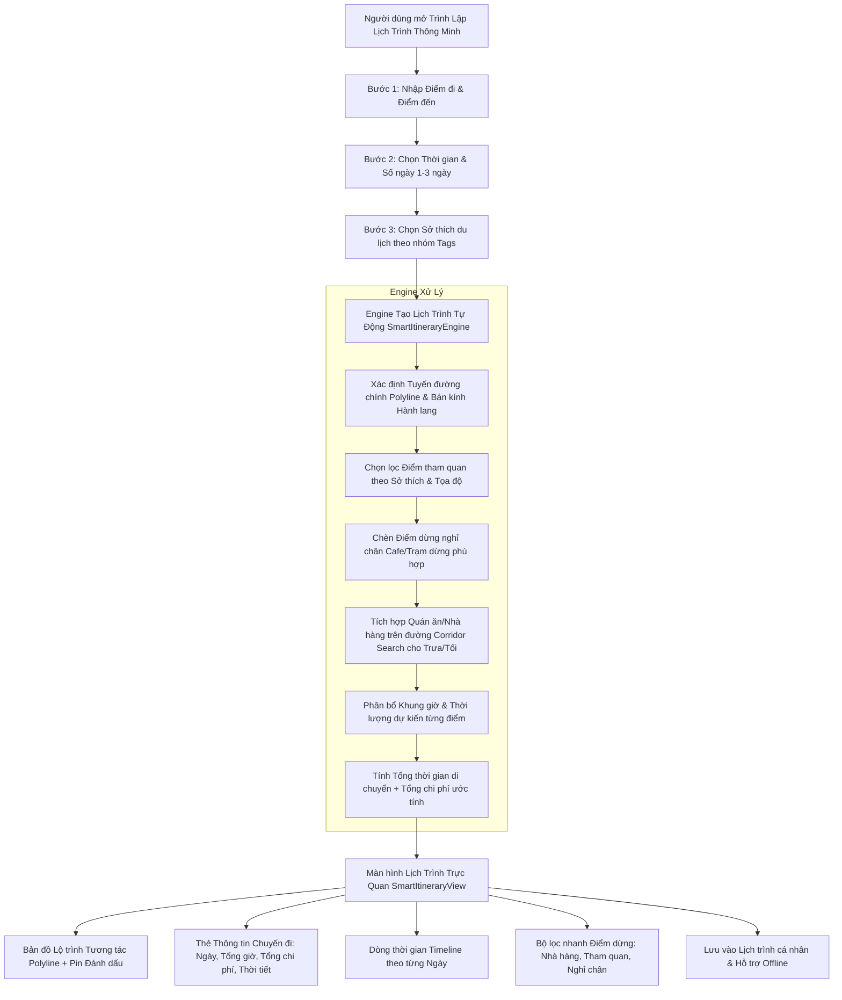

# KẾ HOẠCH PHÁT TRIỂN: TÍNH NĂNG XÂY DỰNG LỊCH TRÌNH THÔNG MINH VIỆT HÓA (SMART ITINERARY & ROUTE PLANNER)

**Dự án:** TripFlow — Nền Tảng Khám Phá Du Lịch, Văn Hóa Ẩm Thực & Lên Lộ Trình Thông Minh  
**Tác nhân thực hiện:** 🧠 Planner Agent (Agent 1)  
**Tài liệu đầu vào:** Yêu cầu người dùng & 4 ảnh giao diện tham chiếu (Dribbble/Figma design)  
**Ngày lập kế hoạch:** 31/10/2026  

---

## 1. TỔNG QUAN YÊU CẦU & MỤC TIÊU

### 1.1 Yêu cầu cốt lõi từ người dùng
Người dùng yêu cầu Việt hóa toàn diện và áp dụng trải nghiệm người dùng cao cấp theo 4 ảnh tham chiếu:
> *"Người dùng nhập điểm xuất phát, điểm đến, thời gian và sở thích. Ứng dụng xây dựng lịch trình bao gồm:*
> *- Tuyến đường di chuyển.*
> *- Các điểm dừng nghỉ chân.*
> *- Địa điểm tham quan du lịch.*
> *- Quán ăn, nhà hàng trên đường.*
> *- Thời gian dự kiến tại từng địa điểm.*
> *- Tổng thời gian và chi phí dự kiến."*

### 1.2 Phân tích thiết kế từ 4 ảnh tham chiếu
1. **Ảnh 1 (`media_...3b70efc2.jpg`)**:
   - Màn hình Trang chủ: Thẻ "Chuyến đi tiếp theo?" (Where to next?) với ảnh Hero ấn tượng, số ngày (3 ngày 2 đêm), số điểm dừng, ngân sách dự kiến.
   - Màn hình Tổng quan Lịch trình (Itinerary Overview): Bản đồ tương tác có vẽ tuyến đường màu đỏ kết nối các điểm dừng có ảnh thu nhỏ, bộ chọn Ngày 1/Ngày 2/Ngày 3, băng chuyền thẻ điểm dừng trượt ngang theo mốc thời gian (`07:00 - 10:00`, `10:00 - 13:00`).
   - Màn hình Thẻ chi tiết điểm dừng: Ảnh nền toàn màn hình, số thứ tự điểm dừng, đánh giá sao, khoảng cách từ vị trí hiện tại (`400 m`), nút Dẫn đường.
2. **Ảnh 2 (`media_...4493a4a3.jpg`)**:
   - Hệ thống tab: Tổng quan (Overview), Lịch trình (Itinerary), Khám phá (Explore), Ngân sách chi phí ($).
   - Nút "⚡ Tối ưu tuyến đường" (Optimize Route).
   - Dòng thời gian chi tiết: Điểm xuất phát -> Thời gian di chuyển -> Điểm tham quan -> Điểm ăn uống với nhãn thời gian trực quan.
3. **Ảnh 3 (`media_...08b1f05f.jpg`)**:
   - Màn hình Thiết lập Sở thích Du lịch: "Bạn yêu thích điều gì?" (Chọn danh mục theo nhóm: Điểm nổi bật, Lịch sử & Di sản, Thiên nhiên & Hoạt động ngoài trời, Ẩm thực & Chợ đêm, Văn hóa nghệ thuật).
   - Khối Thời tiết dự báo: Nhiệt độ, nắng/mưa, độ ẩm cho chuyến đi.
4. **Ảnh 4 (`media_...e9d17de8.jpg`)**:
   - Bản đồ Tìm kiếm điểm dừng trên hành lang di chuyển (Corridor POI Search): Thanh tìm kiếm nhanh các điểm `🍴 Nhà hàng`, `☕ Trạm dừng/Nghỉ chân`, `📷 Danh lam`, `⛽ Cây xăng`.
   - Danh sách điểm dừng tuyến đường với tổng chiều dài (km), tổng thời gian (giờ/phút) và số trạm dừng.

---

## 2. SƠ ĐỒ KIẾN TRÚC & QUY TRÌNH XỬ LÝ (MERMAID)

---

## 3. CẤU TRÚC THƯ MỤC & FILE CẦN TRIỂN KHAI

| STT | File | Hành động | Mục đích |
|---|---|---|---|
| 1 | [`lib/core/utils/smart_itinerary_engine.dart`](file:///d:/trip_flow/lib/core/utils/smart_itinerary_engine.dart) | **Tạo mới** | Thuật toán xây dựng lịch trình thông minh: định tuyến, gán điểm tham quan theo sở thích, chèn điểm dừng chân và quán ăn, tính toán timeline và chi phí |
| 2 | [`lib/features/itinerary/screens/trip_planner_wizard_screen.dart`](file:///d:/trip_flow/lib/features/itinerary/screens/trip_planner_wizard_screen.dart) | **Tạo mới** | Giao diện Wizard nhập Điểm đi, Điểm đến, Ngày/Thời gian và Bộ chọn Sở thích trực quan dạng Chip (theo Ảnh 3) |
| 3 | [`lib/features/itinerary/screens/smart_itinerary_result_screen.dart`](file:///d:/trip_flow/lib/features/itinerary/screens/smart_itinerary_result_screen.dart) | **Tạo mới** | Giao diện hiển thị Lịch trình hiện đại: Bản đồ Polyline, Tabs ngày, Dòng thời gian Timeline với thời gian dự kiến, thẻ tổng chi phí & thời tiết (theo Ảnh 1, 2, 4) |
| 4 | [`lib/features/itinerary/widgets/itinerary_timeline_card.dart`](file:///d:/trip_flow/lib/features/itinerary/widgets/itinerary_timeline_card.dart) | **Tạo mới** | Thẻ điểm dừng dòng thời gian có ảnh Hero, nhãn loại điểm (Tham quan, Nghỉ chân, Ăn uống), thời gian dự kiến, chi phí, khoảng cách |
| 5 | [`lib/features/home/home_screen.dart`](file:///d:/trip_flow/lib/features/home/home_screen.dart) | **Cập nhật** | Thêm Banner nổi bật "Lập Lịch Trình Thông Minh" trên Trang chủ với thiết kế Hero card như Ảnh 1 |
| 6 | [`lib/features/itinerary/itinerary_screen.dart`](file:///d:/trip_flow/lib/features/itinerary/itinerary_screen.dart) | **Cập nhật** | Tích hợp nút tạo lịch trình thông minh và liên kết trực tiếp tới Wizard mới |
| 7 | [`lib/core/utils/app_state.dart`](file:///d:/trip_flow/lib/core/utils/app_state.dart) | **Cập nhật** | Lưu trữ và quản lý các lịch trình thông minh được tạo, đồng bộ trạng thái |

---

## 4. CHI TIẾT TRIỂN KHAI CÁC MODULE

### 4.1 Module Thuật toán: `smart_itinerary_engine.dart`
- **Đầu vào (Input Parameters)**:
  - `provinceId`: Tỉnh/thành đang chọn (VD: TP.HCM, Hà Nội, Đà Nẵng, v.v.).
  - `originDestination`: Địa điểm xuất phát.
  - `targetDestination`: Địa điểm đích đến.
  - `startDate`, `endDate`, `totalDays` (1, 2, hoặc 3 ngày).
  - `selectedPreferences`: Danh sách sở thích (heritage, architecture, street_walk, nature, market, cuisine, relaxation).
  - `budgetLevel`: Mức ngân sách (Tiết kiệm, Tiêu chuẩn, Thoải mái).
- **Thuật toán xử lý**:
  1. Xây dựng tuyến đường polyline nối điểm xuất phát và đích.
  2. Lọc các điểm tham quan dọc hành lang 5km và phù hợp với sở thích được chọn.
  3. Lọc các nhà hàng/quán ăn đặc sản tiêu biểu cho bữa trưa (11:30 - 13:00) và bữa tối (18:30 - 20:00).
  4. Bổ sung các điểm dừng nghỉ chân (Quán cà phê ngắm cảnh, công viên) giữa các chặng di chuyển dài hơn 45 phút.
  5. Sắp xếp thứ tự tối ưu theo địa lý (Tránh đi vòng).
  6. Tính toán chi phí dự kiến = Vé tham quan + Chi phí ăn uống theo bữa + Chi phí di chuyển ước tính.
  7. Tính toán tổng thời gian = Thời gian tham quan + Thời gian ăn uống + Thời gian di chuyển.

### 4.2 Màn hình Nhập Liệu Wizard: `trip_planner_wizard_screen.dart` (Việt hóa 100%)
- **Bước 1: Tuyến đường & Thời gian**:
  - Chọn Điểm xuất phát (có icon ghim xanh).
  - Chọn Điểm đến (có icon cờ đỏ).
  - Chọn Ngày đi & Ngày về (Bộ chọn ngày mượt mà dạng pill ngang).
- **Bước 2: Sở thích du lịch (What excites you - Việt hóa)**:
  - Nhóm 1: *Điểm đến hàng đầu* (⭐ Được yêu thích nhất, 🔥 Xu hướng, 💎 Điểm đến ẩn giấu).
  - Nhóm 2: *Lịch sử & Di sản* (🏛️ Di tích văn hóa, 🏺 Bảo tàng, ⛩️ Đền chùa cổ kính).
  - Nhóm 3: *Thiên nhiên & Ngoài trời* (🌳 Cảnh quan thiên nhiên, 🏖️ Biển đảo, 🚶 Dạo bộ phố đêm).
  - Nhóm 4: *Ẩm thực & Thư giãn* (🍜 Ẩm thực đường phố, ☕ Quán cafe thư giãn, 🛍️ Chợ truyền thống).
- **Nút hành động**:
  - "✨ Xây Dựng Lịch Trình Thông Minh" với hiệu ứng loading và tạo lịch trình ngay lập tức.

### 4.3 Màn hình Hiển Thị Lịch Trình: `smart_itinerary_result_screen.dart`
- **Header**: Bản đồ tương tác hiển thị tuyến đường vẽ polyline, các điểm dừng đánh số thứ tự từ 1 đến N.
- **Thẻ tổng quan chuyến đi**:
  - Số ngày, số điểm dừng.
  - Tổng thời gian di chuyển & tham quan.
  - Tổng chi phí ước tính (kèm chi tiết vé, ăn uống, di chuyển).
  - Dự báo thời tiết địa phương (Nhiệt độ, biểu tượng thời tiết).
- **Bộ chuyển ngày (Day 1, Day 2, Day 3)**:
  - Thanh chọn ngày dạng pill bo cong nổi bật (như Ảnh 1 & 2).
- **Dòng thời gian (Timeline List)**:
  - Điểm xuất phát (Giờ khởi hành).
  - Thời gian di chuyển giữa các chặng (Thời gian lái xe/đi bộ + Khoảng cách km).
  - Điểm dừng tham quan: Ảnh lớn 180px, tên danh thắng, thời gian dự kiến (VD: 90 phút), giá vé.
  - Điểm ăn uống trưa/tối: Tên quán, món đặc sản nên thử, giá trung bình.
  - Điểm dừng chân thư giãn: Cà phê, ngắm cảnh.
  - Điểm kết thúc ngày.
- **Hành động**:
  - "💾 Lưu Lịch Trình Này" (Tự động đưa vào Lịch trình cá nhân của AppState & hỗ trợ Offline).
  - "🧭 Bắt đầu dẫn đường trên Bản đồ".

---

## 5. THỨ TỰ TRIỂN KHAI CHO CODER AGENT

1. **Bước 1**: Tạo file thuật toán [`smart_itinerary_engine.dart`](file:///d:/trip_flow/lib/core/utils/smart_itinerary_engine.dart).
2. **Bước 2**: Tạo widget thẻ dòng thời gian [`itinerary_timeline_card.dart`](file:///d:/trip_flow/lib/features/itinerary/widgets/itinerary_timeline_card.dart).
3. **Bước 3**: Tạo màn hình Wizard nhập liệu [`trip_planner_wizard_screen.dart`](file:///d:/trip_flow/lib/features/itinerary/screens/trip_planner_wizard_screen.dart).
4. **Bước 4**: Tạo màn hình hiển thị kết quả lộ trình [`smart_itinerary_result_screen.dart`](file:///d:/trip_flow/lib/features/itinerary/screens/smart_itinerary_result_screen.dart).
5. **Bước 5**: Tích hợp các nút điều hướng trên [`home_screen.dart`](file:///d:/trip_flow/lib/features/home/home_screen.dart) và [`itinerary_screen.dart`](file:///d:/trip_flow/lib/features/itinerary/itinerary_screen.dart).
6. **Bước 6**: Kiểm thử biên dịch Flutter (`flutter build web`) và Hot restart ứng dụng.
7. **Bước 7**: Chuyển giao sang Reviewer Agent để kiểm duyệt toàn diện.

---

## 6. TIÊU CHÍ NGHIỆM THU (ACCEPTANCE CRITERIA)

- [ ] **AC-1 (Đầy đủ trường nhập liệu)**: Người dùng có thể chọn điểm xuất phát, điểm đến, thời gian (ngày), và sở thích du lịch theo nhóm.
- [ ] **AC-2 (Tuyến đường & Bản đồ)**: Vẽ rõ ràng tuyến đường polyline kết nối các điểm dừng và hiển thị khoảng cách di chuyển giữa từng điểm.
- [ ] **AC-3 (Đầy đủ loại điểm dừng)**: Lịch trình sinh ra có đầy đủ:
  - Điểm tham quan du lịch phù hợp sở thích.
  - Điểm dừng nghỉ chân (Cafe, công viên, trạm dừng).
  - Quán ăn, nhà hàng trên đường (Đặc sản ăn trưa, ăn tối).
- [ ] **AC-4 (Thời gian & Chi phí)**: Mỗi điểm dừng có khung giờ và thời lượng tham quan cụ thể; tổng chi phí dự kiến và tổng thời gian được tính toán minh bạch.
- [ ] **AC-5 (Giao diện chuẩn ảnh mẫu & 100% Việt hóa)**: Bố cục đẹp mắt, hiện đại, hình ảnh chân thực, responsive không bị lỗi overflow.
