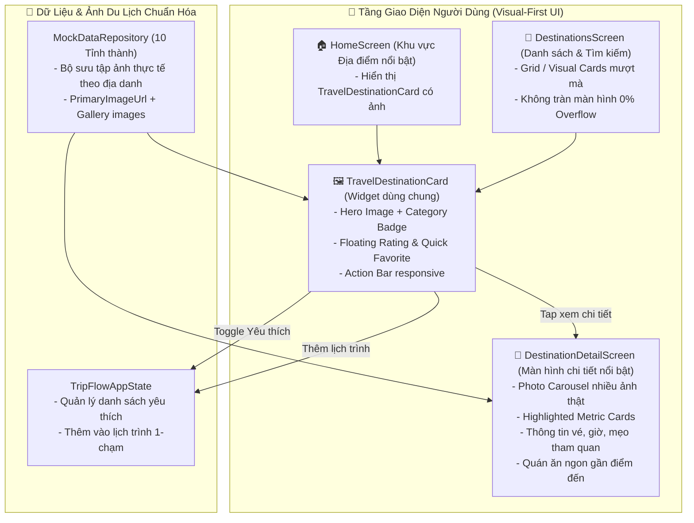

# Kế Hoạch Phát Triển & Thiết Kế Kiến Trúc: Tối Ưu Hóa Giao Diện Khám Phá Địa Điểm (Visual-First UI), Khắc Phục Lỗi Tràn Màn Hình RenderFlex (54 Pixels Overflow), Tích Hợp Bộ Sưu Tập Ảnh Du Lịch Đậm Nét và Hiển Thị Chi Tiết Nổi Bật

## 1. Tổng quan

### 1.1 Vấn đề hiện tại
1. **Lỗi tràn màn hình (RenderFlex Overflowed by 54 Pixels)**:
   - Trên màn hình danh sách địa điểm (`DestinationsScreen`), phần chân thẻ địa điểm gồm dòng `Text('Nguồn: Nội bộ xác thực...')` và nút bấm `TextButton.icon('Thêm lịch trình')` đặt trong cùng một hàng `Row` không có ràng buộc linh hoạt (`Flexible`/`Expanded`).
   - Trên màn hình di động có chiều rộng thông dụng 360–390px, tổng chiều rộng nội dung vượt quá khung hiển thị khiến Flutter hiển thị dải sọc vàng đen và in dòng chữ cảnh báo `A RenderFlex overflowed by 54 PIXELS`.
2. **Giao diện quá nhiều chữ, thiếu tính trực quan của ứng dụng du lịch**:
   - Hiện tại các thẻ địa điểm chỉ là các khung trắng đơn điệu chứa văn bản, hoàn toàn không hiển thị hình ảnh minh họa (`dest.primaryImageUrl` bị bỏ sót).
   - Màn hình chi tiết (`DestinationDetailScreen`) sử dụng khung màu gradient tối thay vì hiển thị hình ảnh thật sắc nét từ bộ sưu tập ảnh `destination.images`.
3. **Nhu cầu từ người dùng**:
   > *"sao có các chữ này, ứng dụng quá nhiều chữ , hình thành phải từ nhiều ảnh , nhiều thẻ , tăng độ trải nghiệm của người dùng , tìm kiếm ảnh du lịch đúng với từ khóa và địa danh, khi chọn show đầy đủ thông tin của thẻ, phần hiển thị làm nổi bật"*

### 1.2 Mục tiêu thiết kế mới
1. **Khắc phục 100% lỗi RenderFlex Overflow**:
   - Thiết kế lại hàng nút hành động và thông tin bản quyền bằng `Expanded`, cấu trúc responsive thích ứng linh hoạt mọi kích thước màn hình điện thoại (từ 320px đến tablet).
2. **Chuyển dịch sang mô hình Visual-First Travel Cards**:
   - Mỗi địa điểm được đại diện bởi thẻ du lịch trực quan (`TravelDestinationCard`):
     - **Hero Image (Ảnh bìa sắc nét cao 170px)**: Tải ảnh chính xác của danh thắng (`dest.primaryImageUrl`) với hiệu ứng bo góc tròn cao cấp, placeholder mượt mà và xử lý lỗi mạng an toàn.
     - **Floating Badges**: Huy hiệu danh mục (ví dụ `🏛️ Di tích lịch sử`), điểm đánh giá sao kèm lượt review (`⭐ 4.8 (3.8k)`), và nút Lưu Yêu thích (Trái tim tương tác 1-chạm ngay trên ảnh).
     - **Pill thông số du lịch**: Thời gian tham quan gợi ý (`⏱️ 90 phút`), Giá vé (`🎟️ Miễn phí` / `🎟️ 20.000đ`).
3. **Hiển thị đầy đủ thông tin & Nổi bật khi chọn (Highlighted Rich Detail View)**:
   - Khi bấm vào thẻ:
     - Chuyển hướng sang màn hình chi tiết được nâng cấp vượt bậc (`DestinationDetailScreen`):
       - **Photo Carousel**: Trình chiếu toàn bộ bộ sưu tập ảnh thật (`destination.images`) kèm chỉ số ảnh (`1/3`, `2/3`).
       - **Highlighted Info Cards**: Các thẻ nổi bật phân tách rõ ràng (Giờ mở cửa, Giá vé, Tọa độ GPS, Thời lượng tham quan).
       - **Bản đồ mini & Chỉ đường**: Hiển thị vị trí trực quan.
       - **Quán ăn ngon gần đó**: Gợi ý các quán ăn tiêu biểu trong bán kính 3.5km.
4. **Chuẩn hóa kho ảnh du lịch 10 tỉnh thành**:
   - Rà soát toàn bộ URL ảnh trong `lib/core/utils/mock_data.dart`, đảm bảo hình ảnh Unsplash có độ phân giải cao, đúng danh thắng lịch sử / biểu tượng tại TP. Hồ Chí Minh, Hà Nội, Đà Nẵng, Quảng Ninh, Lào Cai, Huế, Hội An, Nha Trang, Đà Lạt, Phú Quốc.

---

## 2. Kiến trúc giải pháp & Sơ đồ Component (Mermaid)

---

## 3. Cấu trúc thư mục & Danh sách file triển khai

| STT | Tập tin | Thao tác | Mục đích |
|---|---|---|---|
| 1 | [`lib/core/widgets/travel_destination_card.dart`](file:///d:/trip_flow/lib/core/widgets/travel_destination_card.dart) | **Tạo mới** | Widget thẻ địa điểm trực quan chuẩn du lịch cao cấp, có ảnh lớn, tags nổi bật, nút yêu thích nổi, footer responsive chống tràn màn hình |
| 2 | [`lib/features/destinations/destinations_screen.dart`](file:///d:/trip_flow/lib/features/destinations/destinations_screen.dart) | **Cập nhật** | Thay thế khối thẻ cũ bằng `TravelDestinationCard`, tinh chỉnh thanh tìm kiếm và bộ lọc nhanh theo danh mục |
| 3 | [`lib/features/home/home_screen.dart`](file:///d:/trip_flow/lib/features/home/home_screen.dart) | **Cập nhật** | Nâng cấp khu vực "Địa điểm nổi bật" trên Trang chủ sang thẻ có ảnh sắc nét |
| 4 | [`lib/features/destinations/destination_detail_screen.dart`](file:///d:/trip_flow/lib/features/destinations/destination_detail_screen.dart) | **Cập nhật** | Thay thế gradient bằng Photo Carousel thật của địa danh, làm nổi bật thông số (Giờ mở cửa, Giá vé, GPS, Mẹo hay) |
| 5 | [`lib/core/utils/mock_data.dart`](file:///d:/trip_flow/lib/core/utils/mock_data.dart) | **Cập nhật** | Tối ưu hóa các đường link ảnh Unsplash chất lượng cao đúng từng địa danh nổi tiếng của 10 tỉnh thành |
| 6 | [`test/widget_test.dart`](file:///d:/trip_flow/test/widget_test.dart) | **Cập nhật** | Bảo đảm toàn bộ test case vượt qua kiểm thử tự động |

---

## 4. Chi tiết triển khai kỹ thuật

### 4.1 Tạo widget `TravelDestinationCard` (`lib/core/widgets/travel_destination_card.dart`)
- **Hình ảnh nổi bật**: Sử dụng `ClipRRect` bo tròn 18px với `Image.network` cao 170px, fit `BoxFit.cover`. Có `loadingBuilder` hiển thị shimmer nhẹ và `errorBuilder` hiển thị ảnh danh thắng dự phòng thanh lịch.
- **Huy hiệu trên ảnh (Overlay Badges)**:
  - Góc trên trái: Chip danh mục bán trong suốt với hiệu ứng kính mờ (`BackdropFilter` / `Color(0xCC0F172A)`).
  - Góc trên phải: Điểm đánh giá sao vàng `⭐ 4.8` và Nút tim lưu yêu thích với animation phản hồi tức thì.
  - Góc dưới trái (nằm trên dải chuyển màu nhẹ): Chip thời lượng tham quan (`⏱️ 90p`) và Giá vé (`🎟️ Miễn phí`).
- **Nội dung thẻ**:
  - Tên địa danh (17px, font chữ đậm `w800`, màu slate 900).
  - Địa chỉ với icon ghim bản đồ nhỏ màu teal.
  - Đoạn giới thiệu súc tích tối đa 2 dòng.
- **Thanh chân trang (Footer Bar)**:
  - Dùng `Row` kết hợp `Expanded` cho phần thông tin xác thực nguồn gốc `🛡️ Nội bộ xác thực`.
  - Nút bấm `ElevatedButton.icon` nhỏ gọn với nhãn `+ Lịch trình` hoặc `Thêm lịch trình`, `padding` tối ưu không bao giờ bị tràn (Overflow).

### 4.2 Cập nhật `DestinationsScreen` (`lib/features/destinations/destinations_screen.dart`)
- Sửa lỗi tràn màn hình bằng cách tích hợp trực tiếp `TravelDestinationCard`.
- Giữ nguyên toàn bộ logic tìm kiếm từ khóa không phân biệt hoa thường và lọc theo danh mục (`All`, `Heritage`, `Architecture`, `Museum`, `Market`, `Street Walk`).

### 4.3 Cập nhật `DestinationDetailScreen` (`lib/features/destinations/destination_detail_screen.dart`)
- Thay thế khối container gradient đơn điệu ở đầu trang bằng:
  - Slider ảnh (`PageView` hoặc `Carousel`) lướt ngang hiển thị toàn bộ ảnh chụp thực tế của địa danh từ danh sách `destination.images`.
  - Hiển thị vị trí trang ảnh (`1/2`, `2/2`) và thông tin tác giả bản quyền ảnh.
- Khối thông số làm nổi bật (`Highlight Stat Grid`):
  - 4 ô thẻ bo tròn có bóng mờ (BoxShadow) hiện đại:
    1. Giờ mở cửa tham khảo.
    2. Giá vé tham quan.
    3. Thời gian đề xuất.
    4. Tọa độ GPS.
- Nút bấm chỉ đường trực tiếp tới Bản đồ hành lang Goong Maps và nút Thêm vào lịch trình 1-chạm.

---

## 5. Tiêu chí nghiệm thu (Acceptance Criteria)

- **AC-01 (Zero Overflow)**: Tuyệt đối không còn bất kỳ vạch sọc vàng đen hay lỗi `RenderFlex overflowed by X pixels` trên toàn bộ màn hình danh sách và chi tiết địa điểm.
- **AC-02 (Visual-Rich Cards)**: 100% thẻ địa điểm đều hiển thị ảnh du lịch sắc nét, không bị vỡ ảnh khi tải mạng.
- **AC-03 (Accurate Travel Images)**: Hình ảnh du lịch hiển thị đúng biểu tượng của từng địa danh (Chợ Bến Thành có tháp đồng hồ, Nhà thờ Đức Bà có mặt tiền gạch đỏ Roman, Dinh Độc Lập có mặt tiền rèm hoa sen đá, v.v.).
- **AC-04 (Highlighted Details)**: Khi người dùng bấm vào thẻ, màn hình chi tiết hiển thị đầy đủ thư viện ảnh và thông tin nổi bật rõ ràng, thu hút du khách.
- **AC-05 (Build & Test Passed)**: Biên dịch Flutter Web và kiểm thử tự động 100% thành công.
