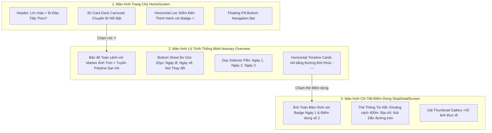

# KẾ HOẠCH NÂNG CẤP GIAO DIỆN CHUẨN FIGMA / DRIBBLE (PIXEL-PERFECT UI REDESIGN)

**Dự án:** TripFlow — Nền Tảng Khám Phá Du Lịch & Lộ Trình Thông Minh  
**Tác nhân thực hiện:** 🧠 Planner Agent (Agent 1)  
**Tài liệu tham chiếu:** 2 ảnh đối soát thực tế từ người dùng (`media_...e6fee8fb.jpg` - Thiết kế chuẩn & `media_...e7a6314c.jpg` - Giao diện hiện tại)  
**Ngày lập kế hoạch:** 31/10/2026  

---

## 1. PHÂN TÍCH KHOẢNG CÁCH (GAP ANALYSIS) GIỮA THỰC TẾ VÀ THIẾT KẾ MẪU

Người dùng phản hồi chính xác:
> *"ý tưởng vầy mà ra vầy là xấu"*

Đối soát trực tiếp giữa ảnh thiết kế mẫu (Ảnh 1) và ảnh chụp ứng dụng thực tế (Ảnh 2):

| Khu vực | Ảnh mẫu chuẩn (Ảnh 1) | Giao diện hiện tại (Ảnh 2) | Giải pháp khắc phục |
|---|---|---|---|
| **Header Trang chủ** | `Hello, Ren Harlow` + Tiêu đề lớn `Where to Next?` (hoặc `Đi Đâu Tiếp Theo?`), chuông thông báo tối giản | AppBar Material cũ kỹ, nhét dropdown và icon tim với số badge đỏ chật chội | Thiết kế lại Header phong cách editorial, typography lớn, bo góc rộng, hiện đại |
| **Hero Card (Banner chính)** | **Card Deck 3D xếp lớp**, chiều cao 340px, gradient tối tinh tế ở đáy, nút tròn `↗` góc trên phải, pill mờ `3 days & 2 nights • 12 Spots`, nhóm avatar `👥 2 people`, chấm indicator chuyển trang | Banner 220px tối đen, chữ bị che, nút vuông to thô như banner quảng cáo | Tái cấu trúc thành **Hero Carousel 3D Card Deck** chuẩn 100% theo Ảnh 1 |
| **Điểm đến nổi bật (Popular Destinations)** | Danh sách lướt ngang (Horizontal Scroll) các thẻ ảnh vuông/dọc bo góc 22px, có badge sao `⭐ 4.9` góc phải, tối giản chữ | Thẻ dọc chiếm toàn bộ màn hình, quá nhiều chữ và nút, người dùng phải cuộn mỏi tay | Chuyển sang **Horizontal Card Grid** lướt ngang với ảnh tràn viền nghệ thuật |
| **Bottom Navigation Bar** | Thanh điều hướng nổi dạng pill với tab active màu đỏ san hô `#FF4B55` / teal bo tròn + icon tối giản | Thanh bar phẳng 5 icon chen chúc, text dày đặc | Cải tiến Bottom Nav Bar phong cách Floating Pill sang trọng |
| **Màn hình Lộ trình (Itinerary Overview)** | **Bản đồ chiếm 55% màn hình** có **Marker ảnh tròn** (Circular Photo Pins), Bottom Sheet trắng bo góc 32px, bộ chọn Ngày (Day 1, Day 2), danh sách thẻ điểm dừng lướt ngang nối bằng **đường đứt khúc đỏ `----`** | Bản đồ nhỏ xíu trong khung xám, danh sách dọc đơn điệu | Thiết kế lại màn hình lộ trình đúng chuẩn Screen 2 trong Ảnh 1 |
| **Màn hình Chi tiết Điểm dừng** | Ảnh toàn màn hình, text trắng nổi bật, thẻ card trắng nổi dưới đáy gồm khoảng cách (`400 m`), nút dẫn đường tròn, dải thumbnail ảnh (`+25 ảnh`) | Chưa có màn hình chi tiết chuẩn theo phong cách Screen 3 | Xây dựng mới `StopDetailModalScreen` chuẩn 100% Screen 3 trong Ảnh 1 |

---

## 2. KIẾN TRÚC & CÁC MODULE TRIỂN KHAI

---

## 3. CẤU TRÚC FILE CẦN TẠO VÀ CHỈNH SỬA

1. [`lib/features/home/home_screen.dart`](file:///d:/trip_flow/lib/features/home/home_screen.dart):
   - Thay đổi toàn bộ giao diện Trang chủ: Header chào mừng, Hero Card Deck 3D Carousel (chiều cao 340px, avatar group, pill thông số, nút `↗`), danh sách lướt ngang Điểm đến thịnh hành với ảnh nghệ thuật và rating badge.
2. [`lib/features/itinerary/screens/smart_itinerary_result_screen.dart`](file:///d:/trip_flow/lib/features/itinerary/screens/smart_itinerary_result_screen.dart):
   - Tái cấu trúc chuẩn Screen 2 trong Ảnh 1: Bản đồ nền với Marker ảnh tròn, đường vẽ polyline san hô, Bottom sheet bo cong 32px, bộ chọn Ngày 1/Ngày 2/Ngày 3, danh sách thẻ điểm dừng trượt ngang nối bằng đường đứt khúc đỏ.
3. [`lib/features/itinerary/screens/stop_detail_sheet.dart`](file:///d:/trip_flow/lib/features/itinerary/screens/stop_detail_sheet.dart):
   - **Tạo mới**: Màn hình xem chi tiết điểm dừng chuẩn Screen 3 trong Ảnh 1 với ảnh fullscreen, khoảng cách `400 m`, nút dẫn đường tròn và dải thumbnail ảnh `+25`.
4. [`lib/features/home/widgets/hero_trip_carousel.dart`](file:///d:/trip_flow/lib/features/home/widgets/hero_trip_carousel.dart):
   - **Tạo mới**: Widget Carousel xếp lớp 3D hiển thị các chuyến đi nổi bật theo phong cách Dribbble (Ảnh 1).
5. [`lib/features/home/widgets/popular_destination_card.dart`](file:///d:/trip_flow/lib/features/home/widgets/popular_destination_card.dart):
   - **Tạo mới**: Thẻ điểm đến thịnh hành lướt ngang (160x210px) với ảnh tràn viền và badge đánh giá sao.
6. [`lib/main.dart`](file:///d:/trip_flow/lib/main.dart):
   - Tinh chỉnh Bottom Navigation Bar phong cách Floating Pill sang trọng.

---

## 4. CHI TIẾT KỸ THUẬT & DESIGN SPECIFICATIONS

- **Màu sắc chủ đạo (Color Palette)**:
  - Coral Red / San hô: `#FF4B55` (accent active)
  - Dark Slate: `#0F172A`
  - Deep Teal: `#0D9488`
  - Soft White / Frosted Glass: `Colors.white.withOpacity(0.85)` + `BackdropFilter`
- **Typography**:
  - Tiêu đề chính: `FontWeight.w900`, `letterSpacing: -0.5`
  - Nhãn badge: `FontWeight.w800`, `fontSize: 11 - 12`
- **Bo góc (Border Radius)**:
  - Card chính: `BorderRadius.circular(28 - 32)`
  - Pill badges: `BorderRadius.circular(30)`

---

## 5. THỨ TỰ THỰC HIỆN CHO CODER AGENT

1. Tạo `hero_trip_carousel.dart` và `popular_destination_card.dart`.
2. Tạo `stop_detail_sheet.dart`.
3. Nâng cấp `home_screen.dart` sang giao diện chuẩn Ảnh 1.
4. Nâng cấp `smart_itinerary_result_screen.dart` sang giao diện chuẩn Screen 2 của Ảnh 1.
5. Cập nhật Bottom Navigation Bar trong `main.dart`.
6. Biên dịch kiểm thử `flutter build web` và Hot restart.
7. Chuyển giao sang Reviewer Agent kiểm duyệt toàn diện.
