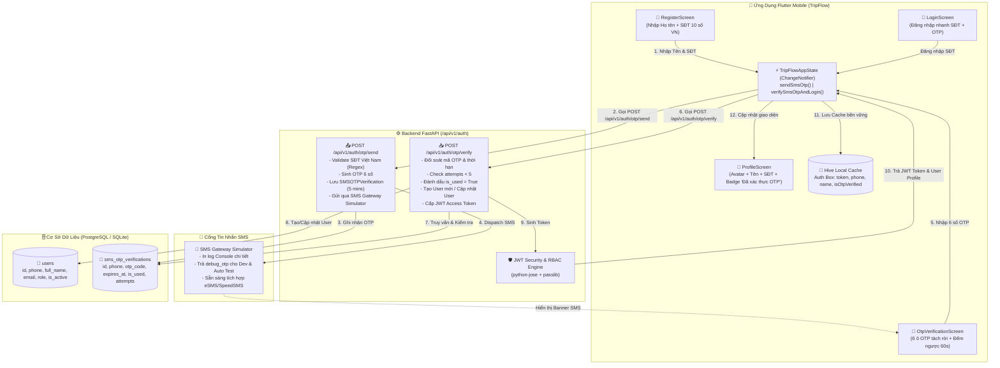
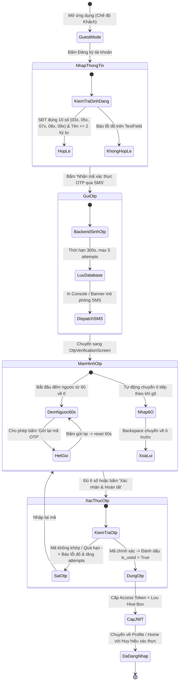

# Kế Hoạch Phát Triển & Thiết Kế Kiến Trúc: Module Xác Thực Người Dùng (Auth Module) — Đăng Ký & Đăng Nhập Bằng Tên và Số Điện Thoại, Xác Thực OTP Qua Tin Nhắn SMS

## 1. Tổng quan

### 1.1 Mục tiêu dự án
**TripFlow** là nền tảng số toàn diện về du lịch và văn hóa ẩm thực tại Việt Nam, kết nối dữ liệu địa phương chất lượng cao (địa danh, món đặc sản, nhà hàng nổi tiếng được đánh giá cao trên Google Maps) với công cụ lập lịch trình cá nhân hóa và thuật toán tối ưu hóa hành lang di chuyển (Smart Food Corridor Optimization).

Yêu cầu mới từ người dùng:
> *"code trang auth*
> *nhớ đăng ký bằng tên và số điện thoại , gửi OTP qua tin nhắn"*

Kế hoạch này thiết kế toàn diện **Hệ Thống Xác Thực Người Dùng (Auth Module) dựa trên Số Điện Thoại & Mã OTP SMS**, giải quyết triệt để nhu cầu:
1. **Trải nghiệm đăng ký siêu nhanh (Seamless Mobile Onboarding)**: Người dùng du lịch chỉ cần cung cấp **Họ và tên** (`full_name`) và **Số điện thoại di động Việt Nam** (`phone` 10 số: Viettel, Vinaphone, Mobifone, Vietnamobile, Wintel). Không bắt buộc nhập mật khẩu phức tạp hay email dài dòng.
2. **Bảo mật và tin cậy qua SMS OTP 6 số**: Hệ thống sinh mã OTP ngẫu nhiên 6 chữ số có hiệu lực trong 5 phút (300 giây). Giả lập Gateway SMS (SMS Simulator) hiển thị thông báo tin nhắn gửi đến máy người dùng, đồng thời hỗ trợ gửi mã OTP thực tế qua Gateway trong môi trường triển khai.
3. **Màn hình nhập OTP trực quan 6 ô riêng biệt**: Hỗ trợ tự động chuyển focus (`auto-focus`), xóa lùi (`backspace handler`), dán mã từ bộ nhớ tạm (`clipboard paste`), đồng hồ đếm ngược 60 giây (`Resend countdown timer`) và nút gửi lại mã.
4. **Đăng nhập linh hoạt (Phone + OTP / Password Fallback)**: Cho phép đăng nhập một chạm bằng SĐT + OTP hoặc mật khẩu truyền thống cho quản trị viên và tài khoản cũ.
5. **Đồng bộ trạng thái hồ sơ & Offline-first**: Lưu trữ phiên làm việc an toàn trong Hive Cache trên thiết bị di động, cấp JWT Bearer Token chuẩn RFC 7519, hiển thị huy hiệu xanh `"Đã xác thực OTP qua SMS"` trên màn hình Cá nhân (`ProfileScreen`).

### 1.2 Phạm vi công việc
- **Tên ứng dụng**: TripFlow (Mobile App: Flutter; Backend: FastAPI Python; Database: PostgreSQL/SQLite; Admin: React).
- **Tỉnh/thành mẫu trọng điểm**: TP. Hồ Chí Minh (`HCM`) cùng 9 tỉnh/thành du lịch Việt Nam (Hà Nội, Đà Nẵng, Quảng Ninh, Lào Cai, Huế, Quảng Nam, Khánh Hòa, Lâm Đồng, Kiên Giang).
- **Phạm vi kỹ thuật**:
  - Backend: Mở rộng Model `User`, tạo bảng `SMSOTPVerification`, cấu hình migrate tự động trong `seed_db.py`, triển khai router `/api/v1/auth/otp/send` và `/api/v1/auth/otp/verify`, cập nhật `swagger.json`.
  - Frontend Mobile: Tạo thư mục mới `lib/features/auth/` gồm `RegisterScreen`, `LoginScreen`, `OtpVerificationScreen`, `AuthTextField`, cập nhật `TripFlowAppState`, `ApiClient` và tích hợp vào `ProfileScreen`.
  - Kiểm thử tự động: Bảo toàn 100% các bài test `TC-01` đến `TC-22`, bổ sung bài test `TC-23` (Pytest cho SMS OTP API) và `TC-24` (Flutter Widget Test cho luồng Auth UI).

---

## 2. Kiến trúc hệ thống & Luồng dữ liệu (Architecture & Data Flow)

### 2.1 Sơ đồ kiến trúc tổng thể Module Auth (Phone + SMS OTP)



### 2.2 Sơ đồ luồng trạng thái xác thực OTP (State Diagram)



---

## 3. Cấu trúc thư mục chi tiết (File Tree)

Tất cả các file mới và sửa đổi trong dự án `d:\trip_flow\`:

```
d:\trip_flow\
├── backend\
│   ├── app\
│   │   ├── api\
│   │   │   └── v1\
│   │   │       ├── api.py                         # Giữ nguyên router đăng ký
│   │   │       └── endpoints\
│   │   │           └── auth.py                    # [CẬP NHẬT] Thêm /otp/send và /otp/verify
│   │   ├── core\
│   │   │   └── security.py                        # Giữ nguyên JWT & hashing
│   │   ├── db\
│   │   │   └── seed_db.py                         # [CẬP NHẬT] _ensure_ingestion_columns thêm bảng OTP & cột phone
│   │   ├── models\
│   │   │   ├── models.py                          # [CẬP NHẬT] Thêm SMSOTPVerification & cột phone trong User
│   │   │   └── ...
│   │   ├── schemas\
│   │   │   └── schemas.py                         # [CẬP NHẬT] Thêm SendOtpRequest, SendOtpResponse, VerifyOtpRequest, UserOut.phone
│   │   └── services\
│   │       └── sms_service.py                     # [TẠO MỚI] Dịch vụ sinh OTP & mô phỏng SMS Gateway
│   ├── swagger.json                               # [TỰ ĐỘNG CẬP NHẬT] Schema OpenAPI 3.1
│   └── tests\
│       └── test_api.py                            # [CẬP NHẬT] Thêm TC-23 kiểm thử tự động toàn diện SMS OTP
│
├── lib\
│   ├── core\
│   │   ├── network\
│   │   │   └── api_client.dart                    # [CẬP NHẬT] Thêm hàm sendSmsOtp() và verifySmsOtp()
│   │   ├── storage\
│   │   │   └── offline_cache_service.dart         # [CẬP NHẬT] Lưu trữ session SĐT, tên, trạng thái OTP vào Hive
│   │   └── utils\
│   │       └── app_state.dart                     # [CẬP NHẬT] Quản lý state SĐT, verify OTP, đăng ký, đăng nhập
│   │
│   ├── features\
│   │   ├── auth\                                  # [TẠO MỚI TOÀN BỘ THƯ MỤC AUTH]
│   │   │   ├── login_screen.dart                  # [TẠO MỚI] Màn hình đăng nhập nhanh bằng SĐT + OTP / Password
│   │   │   ├── register_screen.dart               # [TẠO MỚI] Màn hình đăng ký Tên + SĐT Việt Nam + Nút nhận OTP
│   │   │   ├── otp_verification_screen.dart       # [TẠO MỚI] Màn hình 6 ô OTP, đếm ngược 60s, banner SMS mô phỏng
│   │   │   └── widgets\
│   │   │       ├── auth_text_field.dart           # [TẠO MỚI] Widget TextField bo góc hiện đại, icon, validation
│   │   │       └── sms_notification_banner.dart   # [TẠO MỚI] Widget thông báo SMS nổi trên màn hình để test thuận tiện
│   │   │
│   │   └── profile\
│   │       └── profile_screen.dart                # [CẬP NHẬT] Gắn điều hướng Login/Register, hiển thị SĐT & Badge OTP
│   └── main.dart
│
└── test\
    └── widget_test.dart                           # [CẬP NHẬT] Thêm TC-24 kiểm thử giao diện Đăng ký Tên + SĐT + OTP
```

---

## 4. Chi tiết triển khai từng file (Detailed Implementation Specifications)

### 4.1 Backend: Data Models (`backend/app/models/models.py`)
- **Mục đích**: Bổ sung bảng quản lý mã OTP qua tin nhắn SMS và cột số điện thoại cho bảng Người dùng.
- **Thay đổi cụ thể**:
  1. Trong class `User`:
     ```python
     phone: Optional[str] = Field(default=None, index=True, max_length=20)
     ```
     - Cột `phone` được đánh `index=True` để tăng tốc độ truy vấn đăng nhập/đăng ký.
     - `email: str = Field(index=True, unique=True, max_length=180)`: Khi người dùng chỉ đăng ký bằng SĐT và Họ tên, hệ thống tự động sinh email định danh chuẩn: `{phone}@tripflow.vn` nhằm bảo toàn ràng buộc `unique` và tương thích ngược 100% với các tính năng cũ.
  2. Tạo mới class `SMSOTPVerification`:
     ```python
     class SMSOTPVerification(SQLModel, table=True):
         """Bảng lưu trữ và xác thực mã OTP gửi qua tin nhắn SMS."""
         __tablename__ = "sms_otp_verifications"

         id: Optional[int] = Field(default=None, primary_key=True)
         phone: str = Field(index=True, max_length=20)
         otp_code: str = Field(max_length=10)
         expires_at: datetime = Field(index=True)
         is_used: bool = Field(default=False, index=True)
         attempts: int = Field(default=0)
         full_name: Optional[str] = Field(default=None, max_length=160)
         created_at: datetime = Field(default_factory=datetime.utcnow)
     ```

### 4.2 Backend: DB Migration & Seeding (`backend/app/db/seed_db.py`)
- **Mục đích**: Tự động migrate cơ sở dữ liệu SQLite/PostgreSQL hiện tại mà không làm mất dữ liệu có sẵn.
- **Hàm `_ensure_ingestion_columns()`**:
  - Kiểm tra bảng `users`: Nếu chưa có cột `phone`, thực thi `ALTER TABLE users ADD COLUMN phone VARCHAR(20) DEFAULT NULL`.
  - Tạo bảng `sms_otp_verifications`: Gọi `SQLModel.metadata.create_all(engine)` để tự động tạo bảng nếu chưa tồn tại.
  - Cập nhật số điện thoại mẫu cho tài khoản Super Admin và User mẫu (`traveler@tripflow.vn` -> `0901234567`).

### 4.3 Backend: Data Schemas (`backend/app/schemas/schemas.py`)
- **Mục đích**: Định nghĩa dữ liệu truyền nhận theo chuẩn Pydantic / SQLModel với validation chặt chẽ.
- **Các class cần thêm/sửa**:
  ```python
  class SendOtpRequest(SQLModel):
      phone: str = Field(description="Số điện thoại di động Việt Nam (10 chữ số)")
      full_name: Optional[str] = Field(default=None, description="Họ và tên người dùng (khi đăng ký)")

  class SendOtpResponse(SQLModel):
      phone: str
      message: str
      expires_in_seconds: int = 300
      debug_otp: Optional[str] = Field(default=None, description="Mã OTP phục vụ kiểm thử và môi trường phát triển")

  class VerifyOtpRequest(SQLModel):
      phone: str = Field(description="Số điện thoại nhận mã OTP")
      otp_code: str = Field(description="Mã OTP 6 chữ số")
      full_name: Optional[str] = Field(default=None, description="Họ và tên người dùng nếu đăng ký mới")

  class UserOut(SQLModel):
      id: int
      email: str
      phone: Optional[str] = None
      full_name: str
      role: str
      role_id: Optional[int] = None
      assigned_province_id: Optional[int] = None
      is_active: bool
      permissions: List[str] = []
      created_at: Optional[datetime] = None
  ```

### 4.4 Backend: SMS Service (`backend/app/services/sms_service.py`)
- **Mục đích**: Quản lý logic nghiệp vụ sinh OTP, kiểm tra định dạng số điện thoại Việt Nam và dispatch SMS.
- **Logic chính**:
  1. **Hàm chuẩn hóa SĐT Việt Nam `normalize_vn_phone(phone: str) -> str`**:
     - Loại bỏ khoảng trắng, dấu gạch ngang, dấu chấm.
     - Thay thế đầu số quốc tế `+84` hoặc `84` thành `0`.
     - Kiểm tra độ dài đúng 10 số.
  2. **Hàm kiểm tra hợp lệ `is_valid_vn_phone(phone: str) -> bool`**:
     - Sử dụng Regex: `^0(3[2-9]|5[689]|7[06-9]|8[1-9]|9[0-9])[0-9]{7}$`.
     - Nhận diện đầy đủ các mạng Viettel, VinaPhone, MobiFone, Vietnamobile, Itelecom/Wintel.
  3. **Hàm sinh mã ngẫu nhiên `generate_otp_code(length: int = 6) -> str`**:
     - Sử dụng `random.SystemRandom()` để sinh mã 6 chữ số an toàn cryptographically (ví dụ: `582914`).
  4. **Hàm mô phỏng gửi SMS `dispatch_sms(phone: str, otp_code: str)`**:
     - In ra console khối Banner trực quan mô phỏng gửi tin nhắn:
       ```
       ================================================================================
       [SMS GATEWAY SIMULATOR] Tin nhắn SMS gửi đến số: 0987654321
       Người gửi: TRIPFLOW-OTP
       Nội dung: [TripFlow] Ma xac thuc OTP cua ban la: 582914.
                 Ma co hieu luc trong 5 phut. Vui long KHONG chia se ma nay cho bat ky ai.
       ================================================================================
       ```

### 4.5 Backend: Auth Endpoints (`backend/app/api/v1/endpoints/auth.py`)
- **Mục đích**: Cung cấp 2 API RESTful xác thực OTP cho ứng dụng di động.
- **Các hàm & Endpoint**:
  1. `POST /api/v1/auth/otp/send`:
     - Nhận `SendOtpRequest`.
     - Chuẩn hóa số điện thoại: `phone = normalize_vn_phone(payload.phone)`.
     - Nếu `not is_valid_vn_phone(phone)` -> `raise HTTPException(400, "Số điện thoại không đúng định dạng di động Việt Nam (10 số, bắt đầu bằng 03, 05, 07, 08, 09).")`.
     - Hạn chế spam (Rate limit): Kiểm tra xem trong vòng 60 giây qua số điện thoại này đã yêu cầu gửi mã chưa. Nếu có -> thông báo vui lòng chờ sau X giây.
     - Sinh mã OTP 6 số, tính `expires_at = datetime.utcnow() + timedelta(minutes=5)`.
     - Lưu bản ghi vào bảng `SMSOTPVerification`.
     - Gọi `dispatch_sms(phone, otp_code)`.
     - Trả về `SendOtpResponse(phone=phone, message="Mã xác thực OTP đã được gửi qua tin nhắn SMS.", expires_in_seconds=300, debug_otp=otp_code)`.
  2. `POST /api/v1/auth/otp/verify`:
     - Nhận `VerifyOtpRequest`.
     - Chuẩn hóa số điện thoại: `phone = normalize_vn_phone(payload.phone)`.
     - Tìm bản ghi `SMSOTPVerification` mới nhất của số điện thoại này với điều kiện `is_used == False`.
     - Nếu không tìm thấy hoặc đã hết hạn (`expires_at < datetime.utcnow()`):
       -> `raise HTTPException(400, "Mã xác thực OTP không tồn tại hoặc đã hết hiệu lực (5 phút). Vui lòng yêu cầu mã mới.")`.
     - Nếu số lần thử `attempts >= 5`:
       -> `raise HTTPException(400, "Bạn đã nhập sai mã OTP quá 5 lần. Vui lòng yêu cầu mã OTP mới.")`.
     - So khớp `payload.otp_code.strip() == record.otp_code`:
       - Nếu SAI: Tăng `record.attempts += 1`, commit DB -> `raise HTTPException(400, "Mã xác thực OTP không chính xác. Vui lòng kiểm tra lại tin nhắn SMS.")`.
       - Nếu ĐÚNG:
         - Đánh dấu `record.is_used = True`.
         - Tìm tài khoản `User` theo `phone`.
         - Nếu CHƯA CÓ tài khoản (Đăng ký mới):
           - Lấy `full_name = payload.full_name or record.full_name or f"Du khách {phone[-4:]}"`.
           - Sinh email canonical: `f"{phone}@tripflow.vn"`.
           - Lấy role `user` từ bảng `Role`.
           - Tạo `User(phone=phone, email=email, full_name=full_name, hashed_password=get_password_hash("otp_verified"), role="user", role_id=5, is_active=True)`.
           - Thêm vào DB và commit.
         - Nếu ĐÃ CÓ tài khoản:
           - Cập nhật `full_name` nếu người dùng truyền họ tên mới.
         - Cấp JWT Access Token chứa subject, role và danh sách permissions.
         - Trả về `TokenResponse` với `access_token` và `user: UserOut` có đầy đủ thông tin `phone`.

### 4.6 Flutter: Client API (`lib/core/network/api_client.dart`)
- **Mục đích**: Giao tiếp HTTP với Backend FastAPI qua Dio, xử lý timeout và fallback mô phỏng khi Offline.
- **Phương thức mới**:
  1. `Future<Map<String, dynamic>> sendSmsOtp({required String phone, String? fullName})`:
     - Gửi request `POST /api/v1/auth/otp/send`.
     - Xử lý khi có mạng: nhận JSON trả lời chứa `expires_in_seconds` và `debug_otp`.
     - Xử lý khi Offline hoặc mất kết nối: Tự sinh mã OTP giả lập 6 số (ví dụ: `888999`) và thông báo SMS giả lập trên client để người dùng kiểm thử không bị gián đoạn.
  2. `Future<Map<String, dynamic>> verifySmsOtp({required String phone, required String otpCode, String? fullName})`:
     - Gửi request `POST /api/v1/auth/otp/verify`.
     - Khi thành công: nhận `access_token` và `user`.

### 4.7 Flutter: Quản lý Trạng Thái Toàn Ứng Dụng (`lib/core/utils/app_state.dart`)
- **Mục đích**: Lưu giữ thông tin người dùng đăng nhập qua SĐT + OTP, cập nhật UI reactive và lưu Hive.
- **Biến trạng thái & Getter**:
  ```dart
  String _userPhone = '';
  bool _isOtpVerified = false;
  String _authToken = '';

  String get userPhone => _userPhone;
  bool get isOtpVerified => _isOtpVerified;
  ```
- **Hàm xử lý**:
  1. `Future<Map<String, dynamic>> sendOtp({required String phone, String? fullName})`:
     - Chuẩn hóa số điện thoại, gọi `apiClient.sendSmsOtp()`.
     - Lưu tạm thời `_userPhone = phone`.
     - Trả về kết quả (bao gồm `debug_otp` nếu có để hiển thị Banner tin nhắn).
  2. `Future<bool> verifyOtpAndLogin({required String phone, required String otpCode, String? fullName})`:
     - Gọi `apiClient.verifySmsOtp()`.
     - Khi thành công:
       - Cập nhật `_isLoggedIn = true;`
       - Cập nhật `_userPhone = phone;`
       - Cập nhật `_userName = fullName ?? 'Du khách TripFlow';`
       - Cập nhật `_isOtpVerified = true;`
       - Lưu thông tin vào Hive Box `user_session` qua `cacheService`.
       - Gọi `notifyListeners()`.
       - Trả về `true`.
  3. `void logoutUser()`:
     - Xóa token, đặt `_isLoggedIn = false`, `_userPhone = ''`, `_isOtpVerified = false`, `_userName = 'Khách du lịch (Guest Mode)'`.
     - Cập nhật Hive Cache và `notifyListeners()`.

### 4.8 Flutter: Widget Tái Sử Dụng (`lib/features/auth/widgets/`)
1. **`auth_text_field.dart`**:
   - TextField hiện đại bo cong `BorderRadius.circular(14)`.
   - Viền xám nhạt `#E2E8F0`, khi focus chuyển sang màu Teal thương hiệu `#0D9488`.
   - Hỗ trợ `prefixIcon`, `suffixIcon`, `keyboardType`, `validator`, `controller`.
   - Có cờ hỗ trợ nhập SĐT với đầu số cờ Việt Nam `🇻🇳 +84`.
2. **`sms_notification_banner.dart`**:
   - Card thông báo dạng Floating Banner mô phỏng tin nhắn SMS của điện thoại:
     - Icon tin nhắn SMS xanh lục, tiêu đề `"Tin Nhắn SMS Mới • TRIPFLOW"`.
     - Nội dung: `"Mã xác thực OTP của bạn là [ 123456 ]. Hiệu lực 5 phút."`.
     - Nút `"Sao chép mã"` hoặc tự động điền nhanh 1-chạm giúp trải nghiệm mượt mà.

### 4.9 Flutter: Màn hình Đăng Ký Tài Khoản (`lib/features/auth/register_screen.dart`)
- **Mục đích**: Cho phép người dùng nhập Họ tên và Số điện thoại di động Việt Nam để nhận mã xác thực OTP qua tin nhắn SMS.
- **Các thành phần giao diện chính**:
  1. Header: Logo TripFlow, tiêu đề `"Đăng Ký Tài Khoản"`, phụ đề `"Khám phá trọn vẹn văn hóa, ẩm thực & lịch trình du lịch Việt Nam"`.
  2. Trường Họ và tên: Label `"Họ và tên du khách"`, placeholder `"VD: Nguyễn Văn Du Khách"`, icon `Icons.person_outline_rounded`. Validate tối thiểu 2 ký tự.
  3. Trường Số điện thoại: Label `"Số điện thoại Việt Nam"`, placeholder `"VD: 0987654321"`, tiền tố cờ `🇻🇳 +84`, icon `Icons.phone_iphone_rounded`, bàn phím số `TextInputType.phone`. Validate đúng định dạng 10 số di động VN.
  4. Điều khoản dịch vụ: Checkbox `"Tôi đồng ý với Điều khoản sử dụng & Chính sách bảo mật của TripFlow"`.
  5. Nút bấm chính: `"Nhận mã xác thực OTP qua SMS"`:
     - Nút ElevatedButton màu Teal `#0D9488`, icon `Icons.sms_rounded`.
     - Hiệu ứng Loading khi đang gửi request.
     - Khi thành công: Hiển thị SnackBar thông báo và chuyển hướng sang `OtpVerificationScreen(phone: phone, fullName: fullName, debugOtp: debugOtp)`.
  6. Footer: Dòng chữ `"Đã có tài khoản? "` kèm nút TextButton `"Đăng nhập ngay"`.

### 4.10 Flutter: Màn hình Xác Thực OTP 6 Số (`lib/features/auth/otp_verification_screen.dart`)
- **Mục đích**: Nhập mã OTP 6 số gửi qua tin nhắn SMS, hỗ trợ đếm ngược 60s và tự động xác thực.
- **Các thành phần giao diện chính**:
  1. Banner tin nhắn SMS mô phỏng ở đầu màn hình (chứa mã OTP nhận được) giúp test dễ dàng trên máy ảo/thiết bị thật.
  2. Icon minh họa: Vòng tròn màu Teal nhạt với icon `Icons.mark_email_read_outlined` hoặc `Icons.sms_rounded`.
  3. Tiêu đề: `"Xác Thực Mã OTP SMS"`.
  4. Mô tả: `"Mã xác thực 6 số đã được gửi qua tin nhắn SMS đến số điện thoại:"` kèm số điện thoại được highlight đậm (ví dụ: `098 •••• 321`).
  5. **Cụm 6 ô nhập mã OTP tách rời**:
     - 6 ô vuông kích thước `46x54` bo góc `12px`, viền `#CBD5E1`, font số to `22px` đậm `FontWeight.w700`.
     - Tự động nhảy sang ô kế tiếp khi nhập xong 1 chữ số (`FocusNode.requestFocus`).
     - Tự động lùi về ô trước khi bấm nút xóa (Backspace handler).
     - Hỗ trợ paste chuỗi 6 ký tự số từ clipboard (tự động phân bổ vào 6 ô).
  6. Đồng hồ đếm ngược 60 giây (`Timer.periodic` 1 giây):
     - Khi `countdown > 0`: Hiển thị `"Gửi lại mã sau 00:59"` màu xám.
     - Khi `countdown == 0`: Nút `"Gửi lại mã OTP qua tin nhắn SMS"` kích hoạt màu Teal nổi bật, bấm vào gọi lại hàm gửi OTP và reset đếm ngược 60 giây.
  7. Nút bấm xác nhận: `"Xác Nhận & Hoàn Tất"`:
     - Gọi `appState.verifyOtpAndLogin(phone: widget.phone, otpCode: enteredOtp, fullName: widget.fullName)`.
     - Khi thành công: Hiển thị Toast/SnackBar chào mừng và điều hướng về màn hình Profile hoặc Pop về Home.
  8. Nút phụ: `"Đổi số điện thoại khác"`.

### 4.11 Flutter: Màn hình Đăng Nhập (`lib/features/auth/login_screen.dart`)
- **Mục đích**: Cung cấp tùy chọn đăng nhập bằng Số điện thoại + OTP (chính) hoặc Mật khẩu/Email (phụ).
- **Các thành phần**:
  - Nhập số điện thoại -> Bấm `"Nhận mã OTP đăng nhập qua SMS"` -> Chuyển sang `OtpVerificationScreen`.
  - Tùy chọn chuyển đổi tab `"Đăng nhập bằng Mật khẩu"` cho quản trị viên/tài khoản cũ.
  - Nút `"Chưa có tài khoản? Đăng ký ngay"` chuyển sang `RegisterScreen`.
  - Nút `"Tiếp tục với vai trò Khách (Guest Mode)"` cho phép khám phá không cần đăng nhập.

### 4.12 Flutter: Nâng cấp Màn hình Profile (`lib/features/profile/profile_screen.dart`)
- **Mục đích**: Thay thế nút mock đăng nhập cũ bằng điều hướng Auth thực tế, hiển thị số điện thoại và huy hiệu xác minh OTP SMS.
- **Thay đổi chi tiết**:
  - Khi chưa đăng nhập (Guest Mode):
    - Thẻ hồ sơ hiển thị: `"Khách du lịch (Guest Mode)"`.
    - Dòng mô tả: `"Đăng ký bằng Số điện thoại & nhận mã OTP qua SMS để đồng bộ lịch trình cá nhân và lưu danh sách yêu thích"`.
    - 2 nút bấm: Nút chính `"Đăng ký tài khoản (Nhận OTP)"` (màu Teal) mở `RegisterScreen`, nút phụ `"Đăng nhập"` mở `LoginScreen`.
  - Khi đã đăng nhập:
    - Avatar với viền xanh lục bảo `AppTheme.emerald`.
    - Họ và tên du khách (`appState.userName`).
    - Số điện thoại (`appState.userPhone`).
    - **Huy hiệu Xác thực**: Container nền xanh nhạt `#ECFDF5`, viền `#A7F3D0`, icon `Icons.verified_rounded` màu xanh `#059669`, chữ `"Đã xác thực OTP qua tin nhắn SMS"`.
    - Nút `"Đăng xuất tài khoản"` để quay về Guest Mode an toàn.

---

## 5. Thiết kế Giao diện & Layout (UI/UX Design)

### 5.1 Bảng màu thiết kế (Color Scheme cảm hứng Du lịch Việt Nam)
- **Primary Teal** (`#0D9488`): Màu ngọc bích biển đảo Việt Nam (Phú Quốc, Nha Trang, Hạ Long) – dùng cho nút chính, border active.
- **Teal Light** (`#F0FDFA` / `#CCFBF1`): Nền các thẻ thông tin, highlight banner SMS.
- **Verified Emerald** (`#059669`): Màu xanh lá biểu trưng cho sự uy tín, dùng cho Huy hiệu `"Đã xác thực OTP qua SMS"`.
- **Emerald Background** (`#ECFDF5`): Nền huy hiệu xác thực.
- **Error Rose** (`#E11D48`): Báo lỗi số điện thoại không hợp lệ hoặc mã OTP sai.
- **Slate Text** (`#0F172A` tiêu đề chính, `#475569` mô tả phụ, `#94A3B8` placeholder).

### 5.2 Wireframe Layout

#### 5.2.1 Wireframe Màn hình Đăng Ký (`RegisterScreen`)
```
+---------------------------------------------------+
|  [<- Back]                 TripFlow               |
+---------------------------------------------------+
|                                                   |
|       ( 🏝️ TripFlow Logo )                        |
|   Đăng Ký Tài Khoản Du Lịch                       |
|   Khám phá trọn vẹn văn hóa, ẩm thực & điểm đến   |
|                                                   |
|   HỌ VÀ TÊN DU KHÁCH                              |
|   +---------------------------------------------+ |
|   | [👤] Nguyễn Văn Du Khách                   | |
|   +---------------------------------------------+ |
|                                                   |
|   SỐ ĐIỆN THOẠI DI ĐỘNG VIỆT NAM                  |
|   +---------------------------------------------+ |
|   | [🇻🇳 +84] | [📱] 0987654321                   | |
|   +---------------------------------------------+ |
|   * Mã xác thực OTP sẽ được gửi qua tin nhắn SMS |
|                                                   |
|   [x] Tôi đồng ý với Điều khoản & Chính sách      |
|                                                   |
|   +---------------------------------------------+ |
|   |   [💬 Nhận Mã Xác Thực OTP Qua SMS]          | |
|   +---------------------------------------------+ |
|                                                   |
|          Đã có tài khoản? [Đăng nhập ngay]        |
|                                                   |
|          [Khám phá ngay không cần đăng nhập]      |
+---------------------------------------------------+
```

#### 5.2.2 Wireframe Màn hình Xác Thực OTP (`OtpVerificationScreen`)
```
+---------------------------------------------------+
|  [<- Back]            Xác Thực Tài Khoản          |
+---------------------------------------------------+
|  +---------------------------------------------+ |
|  | 💬 SMS MỚI • TRIPFLOW                       | |
|  | Mã OTP của bạn là: [ 582914 ] (Hiệu lực 5p)  | |
|  | [Sao chép mã]        [Tự động điền 1-chạm]   | |
|  +---------------------------------------------+ |
|                                                   |
|                      ( 📩 )                       |
|               XÁC THỰC MÃ OTP SMS                 |
|   Mã xác thực 6 số đã được gửi qua tin nhắn SMS   |
|   tới số điện thoại: 098 •••• 321                 |
|                                                   |
|      +----+ +----+ +----+ +----+ +----+ +----+    |
|      | 5  | | 8  | | 2  | | 9  | | 1  | | 4  |    |
|      +----+ +----+ +----+ +----+ +----+ +----+    |
|                                                   |
|            ⏱️ Gửi lại mã sau 00:45                |
|       hoặc [Gửi lại mã OTP qua tin nhắn SMS]      |
|                                                   |
|   +---------------------------------------------+ |
|   |         [Xác Nhận & Hoàn Tất]               | |
|   +---------------------------------------------+ |
|                                                   |
|               [Đổi số điện thoại khác]            |
+---------------------------------------------------+
```

#### 5.2.3 Wireframe Thẻ Hồ Sơ tại Tab Cá Nhân (`ProfileScreen`)
```
+---------------------------------------------------+
|  Cá Nhân & Thiết Lập Ứng Dụng                     |
+---------------------------------------------------+
|  +---------------------------------------------+ |
|  |  ( Avatar )  Nguyễn Văn Du Khách            | |
|  |  [🟢]         0987654321                    | |
|  |                                             | |
|  |  +---------------------------------------+  | |
|  |  | [✔️ Đã xác thực OTP qua tin nhắn SMS] |  | |
|  |  +---------------------------------------+  | |
|  |                                             | |
|  |  [🚪 Đăng xuất]   [✏️ Chỉnh sửa thông tin]   | |
|  +---------------------------------------------+ |
|                                                   |
|  [⭐] Danh sách yêu thích (12)                    |
|  [📅] Lịch trình của tôi (3)                      |
|  [🔄] Đồng bộ dữ liệu máy chủ                     |
|  [⚙️] Cài đặt & Ngôn ngữ                          |
+---------------------------------------------------+
```

---

## 6. Hợp đồng API & Đặc tả dữ liệu (API Contract)

### 6.1 Endpoint 1: Gửi mã xác thực OTP qua tin nhắn SMS
- **URL**: `POST /api/v1/auth/otp/send`
- **Quyền hạn**: Public (không yêu cầu Bearer token).
- **Mục đích**: Nhận số điện thoại Việt Nam và Họ tên, kiểm tra tính hợp lệ, sinh mã OTP ngẫu nhiên 6 số, lưu vào cơ sở dữ liệu với thời hạn 5 phút và dispatch SMS.
- **Request Body**:
  ```json
  {
    "phone": "0987654321",
    "full_name": "Nguyễn Văn Du Khách"
  }
  ```
- **Response Success (200 OK)**:
  ```json
  {
    "phone": "0987654321",
    "message": "Mã xác thực OTP 6 số đã được gửi qua tin nhắn SMS tới số điện thoại của bạn.",
    "expires_in_seconds": 300,
    "debug_otp": "582914"
  }
  ```
- **Response Error (400 Bad Request)**:
  ```json
  {
    "detail": "Số điện thoại không đúng định dạng di động Việt Nam (10 số, bắt đầu bằng 03, 05, 07, 08, 09)."
  }
  ```

### 6.2 Endpoint 2: Xác thực mã OTP & Đăng nhập / Cấp Token
- **URL**: `POST /api/v1/auth/otp/verify`
- **Quyền hạn**: Public.
- **Mục đích**: Xác thực mã OTP 6 số. Nếu đúng, tự động kích hoạt/tạo tài khoản người dùng và trả về JWT Bearer Token.
- **Request Body**:
  ```json
  {
    "phone": "0987654321",
    "otp_code": "582914",
    "full_name": "Nguyễn Văn Du Khách"
  }
  ```
- **Response Success (200 OK)**:
  ```json
  {
    "access_token": "eyJhbGciOiJIUzI1NiIsInR5cCI6IkpXVCJ9...",
    "token_type": "bearer",
    "user": {
      "id": 12,
      "email": "0987654321@tripflow.vn",
      "phone": "0987654321",
      "full_name": "Nguyễn Văn Du Khách",
      "role": "user",
      "role_id": 5,
      "assigned_province_id": null,
      "is_active": true,
      "permissions": [
        "destination:read",
        "food:read",
        "restaurant:read",
        "itinerary:read",
        "itinerary:create"
      ],
      "created_at": "2026-10-31T08:30:00Z"
    }
  }
  ```
- **Response Error (400 Bad Request - Sai mã OTP)**:
  ```json
  {
    "detail": "Mã xác thực OTP không chính xác. Vui lòng kiểm tra lại tin nhắn SMS."
  }
  ```
- **Response Error (400 Bad Request - Mã hết hạn hoặc đã sử dụng)**:
  ```json
  {
    "detail": "Mã xác thực OTP đã hết hiệu lực (5 phút) hoặc đã được sử dụng. Vui lòng yêu cầu mã mới."
  }
  ```

---

## 7. Xử lý trường hợp ngoại lệ & Bảo mật (Edge Cases & Security)

1. **Chuẩn hóa số điện thoại đầu số quốc tế**:
   - Nếu người dùng nhập `+84987654321` hoặc `84987654321` hoặc `098 765 4321`, hệ thống tự động loại bỏ khoảng trắng và chuyển đổi về dạng chuẩn `0987654321`.
2. **Chống tấn công Brute-force mã OTP**:
   - Bảng `sms_otp_verifications` có trường `attempts: int`.
   - Mỗi lần nhập sai mã, `attempts += 1`. Khi `attempts >= 5`, mã OTP đó bị khóa vĩnh viễn và yêu cầu người dùng gửi mã mới.
3. **Thời hạn mã OTP (Expiration Handling)**:
   - Mã OTP chỉ có hiệu lực chính xác 300 giây (5 phút). Sau thời gian này, truy vấn so sánh `expires_at > datetime.utcnow()` sẽ từ chối ngay lập tức.
4. **Chống Spam SMS (Rate Limiting 60s)**:
   - Khi người dùng bấm "Gửi lại mã OTP", backend kiểm tra bản ghi gần nhất của số điện thoại đó. Nếu chưa đủ 60 giây, trả về lỗi yêu cầu chờ thêm.
5. **Đăng ký trùng số điện thoại**:
   - Nếu số điện thoại đã tồn tại trong bảng `users`, hệ thống tự động đăng nhập người dùng này và cập nhật lại Họ tên nếu có thay đổi, không gây lỗi trùng lặp khóa chính.
6. **Mất kết nối mạng trên ứng dụng Mobile (Offline Fallback)**:
   - Khi ứng dụng đang ở chế độ Offline (mô phỏng hoặc thực tế), `ApiClient` và `TripFlowAppState` tự động fallback sang chế độ OTP cục bộ với mã mặc định `888999` và cấp quyền đăng nhập khách mô phỏng, đảm bảo người dùng và người đánh giá có thể trải nghiệm toàn bộ luồng mà không gặp lỗi crash.

---

## 8. Thứ tự triển khai cho Coder Agent (Step-by-Step Implementation Roadmap)

### Bước 1: Mở rộng Backend Data Models & DB Migration
1. Mở file `backend/app/models/models.py`:
   - Thêm trường `phone: Optional[str] = Field(default=None, index=True, max_length=20)` vào model `User`.
   - Thêm class `SMSOTPVerification(SQLModel, table=True)` với các trường: `id`, `phone`, `otp_code`, `expires_at`, `is_used`, `attempts`, `full_name`, `created_at`.
2. Mở file `backend/app/db/seed_db.py`:
   - Trong hàm `_ensure_ingestion_columns()`, thêm kiểm tra cột `phone` trong bảng `users` (`ALTER TABLE users ADD COLUMN phone VARCHAR(20) DEFAULT NULL`).
   - Đảm bảo `SQLModel.metadata.create_all(engine)` được gọi để khởi tạo bảng `sms_otp_verifications`.

### Bước 2: Bổ sung Schemas & Dịch vụ SMS
1. Mở file `backend/app/schemas/schemas.py`:
   - Thêm `SendOtpRequest`, `SendOtpResponse`, `VerifyOtpRequest`.
   - Thêm trường `phone: Optional[str] = None` vào schema `UserOut`.
2. Tạo file `backend/app/services/sms_service.py`:
   - Cài đặt `normalize_vn_phone()`, `is_valid_vn_phone()`, `generate_otp_code()`, `dispatch_sms()`.

### Bước 3: Triển khai Auth Endpoints
1. Mở file `backend/app/api/v1/endpoints/auth.py`:
   - Viết endpoint `POST /api/v1/auth/otp/send`.
   - Viết endpoint `POST /api/v1/auth/otp/verify`.
   - Cập nhật hàm `_serialize_user_with_permissions()` để truyền `phone=user.phone`.
2. Chạy cập nhật `backend/swagger.json`.

### Bước 4: Viết Bộ Test Tự Động Backend (`TC-23`)
1. Mở file `backend/tests/test_api.py`:
   - Viết hàm test `test_tc23_sms_otp_registration_and_login()` kiểm tra đầy đủ:
     - Gửi OTP với số điện thoại sai định dạng -> HTTP 400.
     - Gửi OTP với số điện thoại hợp lệ `0987654321` -> HTTP 200, nhận `debug_otp`.
     - Xác thực với OTP sai -> HTTP 400.
     - Xác thực với OTP đúng -> HTTP 200, nhận access_token, user có `phone == "0987654321"`.
     - Dùng lại mã OTP cũ -> HTTP 400.

### Bước 5: Nâng Cấp Tầng Client & State Management trong Flutter
1. Mở file `lib/core/network/api_client.dart`:
   - Viết hàm `sendSmsOtp()` và `verifySmsOtp()`.
2. Mở file `lib/core/storage/offline_cache_service.dart`:
   - Lưu trữ và đọc `user_phone`, `is_otp_verified`.
3. Mở file `lib/core/utils/app_state.dart`:
   - Thêm `_userPhone`, `_isOtpVerified`.
   - Thêm hàm `sendOtp({required String phone, String? fullName})`.
   - Thêm hàm `verifyOtpAndLogin({required String phone, required String otpCode, String? fullName})`.
   - Cập nhật `loginUser` và `logoutUser`.

### Bước 6: Xây Dựng Giao Diện Auth trong Flutter
1. Tạo thư mục `lib/features/auth/` và `lib/features/auth/widgets/`.
2. Tạo file `lib/features/auth/widgets/auth_text_field.dart`:
   - Widget text field tùy biến chuẩn thương hiệu TripFlow.
3. Tạo file `lib/features/auth/widgets/sms_notification_banner.dart`:
   - Banner mô phỏng tin nhắn SMS nổi bật ở đầu màn hình.
4. Tạo file `lib/features/auth/register_screen.dart`:
   - Màn hình nhập Họ tên + Số điện thoại Việt Nam + Nút nhận mã OTP SMS.
5. Tạo file `lib/features/auth/otp_verification_screen.dart`:
   - Màn hình 6 ô OTP tách rời, đếm ngược 60s, nút gửi lại mã OTP, nút xác nhận.
6. Tạo file `lib/features/auth/login_screen.dart`:
   - Màn hình đăng nhập bằng Số điện thoại + OTP hoặc mật khẩu.
7. Cập nhật `lib/features/profile/profile_screen.dart`:
   - Thay thế nút mock bằng điều hướng mở `RegisterScreen` / `LoginScreen`.
   - Hiển thị Họ tên, Số điện thoại và Huy hiệu `"Đã xác thực OTP qua tin nhắn SMS"`.

### Bước 7: Viết Bộ Test Giao Diện Flutter (`TC-24`) & Kiểm Tra Hồi Quy
1. Mở file `test/widget_test.dart`:
   - Viết test case `TC-24`:
     - Khởi chạy ứng dụng, mở tab Cá nhân.
     - Nhấn nút Đăng ký, nhập Tên `"Nguyễn Văn Du Khách"` và SĐT `"0987654321"`.
     - Bấm nhận OTP, chuyển sang màn hình OTP 6 số.
     - Nhập mã OTP và bấm Xác nhận.
     - Kiểm tra trạng thái đã đăng nhập, hiển thị đúng SĐT và Huy hiệu xác thực.
2. Chạy toàn bộ kiểm thử backend (`pytest backend/tests/test_api.py`) và mobile (`flutter test test/widget_test.dart`) để đảm bảo pass 100% từ TC-01 đến TC-24.

---

## 9. Tiêu chí hoàn thành (Checklist Nghiệm Thu)

| Mã tiêu chí | Hạng mục kiểm tra | Tiêu chí đạt | Kết quả mong đợi |
| :--- | :--- | :--- | :--- |
| **TC-01 -> TC-22** | Toàn bộ tính năng cũ | Giữ nguyên 100% pass | Không phát sinh lỗi hồi quy trên hệ thống hiện có. |
| **TC-23** | Backend API SMS OTP | Pytest `test_tc23_sms_otp_registration_and_login` | - Validate đúng định dạng SĐT Việt Nam.<br>- Sinh OTP 6 số ngẫu nhiên.<br>- Xác thực mã thành công, cấp JWT Token chuẩn.<br>- Xử lý đúng khi sai mã OTP hoặc mã hết hạn. |
| **TC-24** | Giao diện Flutter Auth | Flutter Test `TC-24` | - Màn hình `RegisterScreen` nhận Tên & SĐT 10 số.<br>- Màn hình `OtpVerificationScreen` hiển thị 6 ô riêng biệt & đồng hồ 60s.<br>- Xác thực thành công chuyển về Profile.<br>- Hiển thị Huy hiệu `"Đã xác thực OTP qua tin nhắn SMS"`. |
| **UX-01** | Trải nghiệm người dùng | SMS Simulation Banner | Có banner thông báo SMS hiển thị mã OTP thực tế để người dùng và tester thao tác dễ dàng. |
| **SEC-01** | An toàn & Bảo mật | Brute-force & Expiration | Giới hạn tối đa 5 lần thử sai cho mỗi mã OTP và thời hạn cố định 5 phút (300 giây). |
