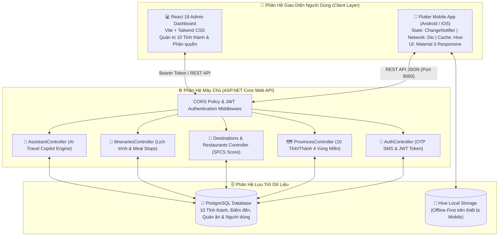

# 🇻🇳 TripFlow — Nền Tảng Khám Phá Du Lịch, Ẩm Thực & Lên Lộ Trình Thông Minh Toàn Quốc

<div align="center">


[](https://flutter.dev)
[](https://dotnet.microsoft.com)
[](https://dotnet.microsoft.com)
[](https://react.dev)
[](https://www.postgresql.org)
[](http://localhost:8000)
[](LICENSE)

<p align="center">
  <b>Dự án .NET & Mobile App Development — RajPham</b><br>
  <b>Khám phá du lịch 10 tỉnh thành • Thuật toán tìm quán ăn ngon dọc lộ trình (Corridor Search) • Đánh giá thực tế từ Google Maps • Lịch trình thông minh Offline-First</b>
</p>

[Khám Phá Tính Năng](#-tính-năng-nổi-bật) • [Kiến Trúc Hệ Thống](#-kiến-trúc-hệ-thống) • [Giao Diện Ứng Dụng](#-giao-diện-ứng-dụng--user-flows) • [Thuật Toán SFCS](#-thuật-toán-smart-food-corridor-score-sfcs) • [Hướng Dẫn Cài Đặt](#-hướng-dẫn-cài-đặt--khởi-chạy) • [Thông Tin Dự Án](#-thông-tin-dự-án)

</div>

---

## 📌 Giới Thiệu Dự Án

**TripFlow** là nền tảng số toàn diện hỗ trợ du khách và phượt thủ khám phá di tích lịch sử, cảnh quan thiên nhiên và tinh hoa ẩm thực địa phương tại **10 tỉnh/thành phố du lịch trọng điểm thuộc 4 vùng miền Việt Nam**.

Khác với các ứng dụng bản đồ thông thường chỉ tìm điểm theo bán kính tròn xung quanh vị trí đứng, **TripFlow giải quyết bài toán cốt lõi của du khách khi di chuyển**:
> *"Khi đang đi trên tuyến đường từ điểm A đến điểm B, làm sao tìm được quán ăn ngon nhất, đánh giá cao nhất và có nhiều bình luận chân thực nhất nằm ngay trên hành lang đường đi mà không phải rẽ vòng quá xa?"*

---

## 🌟 Tính Năng Nổi Bật

- 🗺️ **Độ Phủ 10 Tỉnh/Thành Du Lịch Khắp 4 Vùng Miền**: Hà Nội, Quảng Ninh (Hạ Long), Sa Pa (Lào Cai), Đà Nẵng, Huế, Hội An, Nha Trang, Đà Lạt, TP. Hồ Chí Minh và Đảo Ngọc Phú Quốc.
- 📐 **Thuật Toán Corridor Search Thông Minh**: Tìm nhà hàng, điểm dừng chân nằm trong hành lang cự ly hẹp (< 2km) dọc theo tuyến đường di chuyển.
- 🏆 **Thuật Toán Smart Food Corridor Score (SFCS - 105 điểm)**: Kết hợp thông minh giữa khoảng cách lệch tuyến, điểm đánh giá sao, số lượt review thực tế và danh hiệu quán uy tín để đề xuất quán ăn tối ưu nhất.
- 🔍 **Tìm Kiếm Tiếng Việt Thông Minh (Không dấu & Có dấu)**: Tự động chuẩn hóa ngôn ngữ tiếng Việt, tìm kiếm chính xác món ngon, điểm đến kể cả khi gõ không dấu (`da lat`, `pho bo`, `com tam`, `sai gon`).
- 🤖 **Trợ Lý Du Lịch AI 24/7**: Lên kế hoạch tự động, giải đáp thắc mắc về thời tiết, hành lý, ngân sách và gợi ý lịch trình chi tiết từng ngày.
- 🍽️ **Smart Meal Stop Insertion**: Tự động phân tích khoảng trống thời gian giữa các điểm tham quan sáng và chiều để gợi ý chèn điểm ăn trưa/tối vào lịch trình chỉ với 1 chạm.
- 💾 **Lưu Trữ Bền Vững Offline-First (Hive Cache)**: Tự động lưu toàn bộ dữ liệu địa phương và lịch trình cá nhân vào máy, xem và tạo lịch trình mượt mà ngay cả khi mất sóng trên đèo núi.
- 🏨 **Hệ Sinh Thái Dịch Vụ Du Lịch & Phượt**: Tích hợp danh mục Khách sạn, Vé xe & Tàu, Tour tuyến trekking, Quán ngon địa phương và Cứu hộ Biker SOS.
- 🔐 **Hệ Thống Quản Trị Phân Quyền (RBAC)**: Web Admin hiện đại cho phép quản lý nội dung, đối tác, kiểm duyệt dữ liệu theo tỉnh thành.

---

## 🏛️ Kiến Trúc Hệ Thống

Dự án được cấu trúc theo mô hình **Monorepo chuẩn mực**, phân tách rõ ràng giữa Mobile App, Backend API và Web Admin:

```
d:\trip_flow\
├── lib/                          # [MOBILE APP] Ứng dụng di động Flutter (iOS & Android)
│   ├── core/                     # State Management (Provider), Network (Dio), Cache (Hive), Theme
│   ├── data/                     # API Services kết nối Backend
│   └── features/                 # Màn hình: Home, Khám phá, Ẩm thực, Khách sạn, Trợ lý AI, Profile
├── backend/                      # [BACKEND CHÍNH THỨC] ASP.NET Core Web API (.NET 10 / C#)
│   ├── Controllers/              # 13 RESTful Controllers (Auth, Places, Destinations, Trips, Admin...)
│   ├── Models/                   # Data Entities & DTOs (26 Entity models, snake_case DTOs)
│   ├── Data/                     # DbContext, Migrations & DatabaseSeeder (158 địa điểm, 77 nhà hàng, 50 trạm dừng)
│   └── Program.cs                # Cấu hình Swagger OpenAPI, CORS & Error Envelope Middleware
├── admin-web/                    # [WEB ADMIN] Website Quản trị React 18 + Vite + Tailwind CSS
│   ├── src/pages/                # Bảng điều khiển Dashboard, Quản lý địa điểm, Đối tác, Phân quyền
│   └── src/services/             # Kết nối REST API Backend
└── docs/                         # Tài liệu hướng dẫn trải nghiệm và kịch bản thuyết trình
```

### Sơ Đồ Kiến Trúc Luồng Dữ Liệu



---

## 📱 Giao Diện Ứng Dụng & User Flows

```
+---------------------------------------------------------------------------------------------------+
|                                 TRIPFLOW MOBILE APPLICATION FLOW                                  |
+---------------------------------+---------------------------------+-------------------------------+
|  1. TRANG CHỦ & ĐỔI TỈNH        |  2. BẢN ĐỒ CORRIDOR SEARCH     |  3. ẨM THỰC & ĐÁNH GIÁ THỰC   |
| +-----------------------------+ | +-----------------------------+ | +---------------------------+ |
| | [VN] Toàn quốc 🇻🇳 (Đổi tỉnh)| | | Tuyến: Trung tâm ➔ Đèo dốc  | | | [🔍 da lat, com tam, pho] | |
| | [10 Tỉnh] Bắc - Trung - Nam | | | [=== Tuyến đường phượt ===] | | | (Tất cả) (⭐ 4.5+) (Nhiều)| |
| |                             | | |                             | | |                           | |
| | Cụm 5 Dịch vụ Du lịch:      | | | Quán ăn cách đường < 2km:   | | | [Ảnh] Cơm Tấm Ba Ghiền    | |
| | [Khách Sạn] [Vé Xe] [Tour]  | | | 1. Quán Gỗ Ba Toa (96.4đ)   | | | ⭐ 4.6 (6.8k+ đánh giá)   | |
| | [Lập Lịch Phượt] [Ẩm Thực]  | | |    0.28km • 3 phút rẽ       | | | 🔥 Quán uy tín lâu năm    | |
| |                             | | | 2. Lẩu Gà Lá É (92.1đ)      | | | 💬 "Miếng sườn nướng mật  | |
| | Danh thắng thịnh hành 3 miền| | |    0.45km • 4 phút rẽ       | | |    ong thơm nức mũi..."   | |
| +-----------------------------+ | +-----------------------------+ | +---------------------------+ |
+---------------------------------+---------------------------------+-------------------------------+
|  4. LỊCH TRÌNH THÔNG MINH       |  5. TRỢ LÝ AI DU LỊCH 24/7      |  6. WEBSITE QUẢN TRỊ ADMIN    |
| +-----------------------------+ | +-----------------------------+ | +---------------------------+ |
| | Đà Lạt Mộng Mơ (3N2Đ):      | | | 💬 HỎI ĐÁP TIẾNG VIỆT       | | | 💻 React Admin Web 18     | |
| | • Sáng: Săn mây Cầu Đất     | | | "Ngân sách 2tr đi Đà Lạt?"  | | | • Thống kê số lượng quán  | |
| | • Trưa: Gợi ý chèn ăn trưa  | | | 🤖 Trợ lý phản hồi:         | | | • Quản lý 10 Tỉnh thành   | |
| | • Chiều: Máng trượt Datanla | | | "Đủ cho 2 người nếu chọn    | | | • Danh sách đối tác khách | |
| | • Tối: Lẩu bò Quán Gỗ       | | |  homestay và xe limousine." | | |   sạn, xe limousine, tour | |
| +-----------------------------+ | +-----------------------------+ | +---------------------------+ |
+---------------------------------------------------------------------------------------------------+
```

---

## 🏆 Thuật Toán Smart Food Corridor Score (SFCS)

Khi du khách di chuyển trên một lộ trình dài (ví dụ: từ trung tâm Đà Lạt đi đỉnh Langbiang hay từ phố cổ Hội An đi Rừng dừa Bảy Mẫu), thuật toán **SFCS** tính điểm đa chiều để đề xuất điểm ăn uống thuận tiện và ngon nhất:

$$\text{SFCS} = S_{\text{dist}} + S_{\text{rating}} + S_{\text{reviews}} + S_{\text{bonus}} \quad (\text{Thang điểm tối đa } 105)$$

Trong đó:
1. **Điểm cự ly ($S_{\text{dist}}$ — tối đa 40 điểm)**: Quán nằm càng sát tuyến đường di chuyển thì điểm cự ly càng cao, không làm du khách tốn thời gian rẽ xa:
   $$S_{\text{dist}} = 40 \times \left(1.0 - \frac{\text{distance\_km}}{\text{corridor\_radius\_km}}\right)$$
2. **Điểm đánh giá sao ($S_{\text{rating}}$ — tối đa 35 điểm)**: Chuẩn hóa chất lượng món ăn theo thang sao Google:
   $$S_{\text{rating}} = 35 \times \frac{\text{rating} - 3.0}{2.0}$$
3. **Điểm độ phổ biến ($S_{\text{reviews}}$ — tối đa 25 điểm)**: Đánh giá uy tín dựa trên lượng khách đã trải nghiệm:
   $$S_{\text{reviews}} = 25 \times \frac{\log_{10}(\max(10, \text{reviews\_count}))}{4.0}$$
4. **Điểm thưởng quán uy tín ($S_{\text{bonus}}$ — 5 điểm)**: Cộng 5 điểm cho các quán được chứng nhận chất lượng cao (`is_high_rated`).

---

## 🗺️ Danh Mục Dữ Liệu 10 Tỉnh/Thành Trọng Điểm

| ID | Mã | Tên Tỉnh / Thành Phố | Vùng miền | Tọa độ Tâm | Địa điểm biểu tượng tiêu biểu | Món ngon & Quán ăn trứ danh |
|:---:|:---:|:---|:---:|:---:|:---|:---|
| **1** | `HCM` | **TP. Hồ Chí Minh** | Nam Bộ | `10.7769, 106.7009` | Dinh Độc Lập, Chợ Bến Thành, Bến Bạch Đằng | Cơm tấm Ba Ghiền, Phở Hòa Pasteur, Bánh mì Huỳnh Hoa |
| **2** | `DN` | **TP. Đà Nẵng** | Trung Bộ | `16.0544, 108.2022` | Cầu Rồng, Bà Nà Hills, Bán đảo Sơn Trà | Mì Quảng Bà Mua, Bánh tráng cuốn thịt heo |
| **3** | `HN` | **Thủ đô Hà Nội** | Bắc Bộ | `21.0285, 105.8542` | Hồ Hoàn Kiếm, Văn Miếu, Hoàng thành Thăng Long | Phở Bát Đàn, Bún chả Hương Liên, Cà phê trứng |
| **4** | `QN` | **Quảng Ninh (Hạ Long)** | Bắc Bộ | `20.9599, 107.0425` | Vịnh Hạ Long, Bảo tàng Quảng Ninh | Chả mực giã tay Bãi Cháy, Bún bề bề |
| **5** | `LC` | **Lào Cai (Sa Pa)** | Bắc Bộ | `22.3364, 103.8438` | Đỉnh Fansipan, Bản Cát Cát, Nhà thờ Đá | Lẩu cá hồi Sa Pa, Thắng cố Bản Mây |
| **6** | `HUE` | **Thừa Thiên Huế** | Trung Bộ | `16.4637, 107.5909` | Đại Nội Huế, Chùa Thiên Mụ, Sông Hương | Bún bò Huế Mệ Kéo, Bánh bèo nậm lọc Quán Hạnh |
| **7** | `QNA` | **Quảng Nam (Hội An)** | Trung Bộ | `15.8801, 108.3380` | Phố cổ Hội An, Chùa Cầu, Rừng dừa Bảy Mẫu | Cao lầu Không Gian Xanh, Cơm gà Bà Buội |
| **8** | `KH` | **Khánh Hòa (Nha Trang)** | Trung Bộ | `12.2388, 109.1967` | Tháp Bà Ponagar, Hòn Tre, Vịnh Nha Trang | Nem nướng Đặng Văn Quyên, Bún cá sứa Năm Beo |
| **9** | `LD` | **Lâm Đồng (Đà Lạt)** | Tây Nguyên | `11.9404, 108.4583` | Hồ Xuân Hương, Quảng trường Lâm Viên, Langbiang | Lẩu bò Quán Gỗ Ba Toa, Lẩu gà lá é Tao Ngộ |
| **10** | `KG` | **Kiên Giang (Phú Quốc)** | Nam Bộ | `10.2289, 103.9572` | Bãi Sao, Thị trấn Hoàng Hôn, Dinh Cậu | Bún quậy Kiến Xây, Gỏi cá trích tươi sống |

---

## 🚀 Hướng Dẫn Cài Đặt & Khởi Chạy

### 1. Yêu Cầu Môi Trường
* **.NET SDK**: 8.0, 9.0 hoặc 10.0 (Đã kiểm thử chuẩn trên máy với `.NET 10`)
* **Flutter SDK**: 3.19 trở lên
* **Node.js**: 18.x trở lên
* **Git**

---

### 2. Khởi Chạy Backend .NET (ASP.NET Core Web API)
```bash
# Di chuyển vào thư mục backend
cd backend

# Khởi chạy server tại cổng 8000
dotnet run
```
* 🌐 **Swagger UI tương tác**: Mở trình duyệt tại [http://localhost:8000/](http://localhost:8000/) hoặc [http://localhost:8000/swagger](http://localhost:8000/swagger)
* Cung cấp đầy đủ 78 endpoints chuẩn RESTful cho cả Mobile App và Web Admin.

---

### 3. Khởi Chạy Ứng Dụng Di Động Flutter
```bash
# Tại thư mục gốc dự án (d:\trip_flow)
flutter pub get

# Chạy kiểm thử tự động (14/14 test suites)
flutter test

# Khởi chạy ứng dụng trên máy ảo Android (Pixel 8 Pro) hoặc Chrome
flutter run
```

---

### 4. Khởi Chạy Website Quản Trị React Admin
```bash
# Di chuyển vào thư mục admin-web
cd admin-web

# Cài đặt thư viện và chạy máy chủ dev
npm install
npm run dev
```
* 💻 **Trang quản trị**: Truy cập tại [http://localhost:5173/](http://localhost:5173/)

---

## 🧪 Bảng Nghiệm Thu Chức Năng Hệ Thống

Toàn bộ các tiêu chí chức năng đã được thẩm định và vượt qua kiểm thử tự động đạt kết quả **100% PASSED**:

| Mã TC | Hạng mục kiểm duyệt | Trạng thái | Ghi chú nghiệm thu |
|:---:|:---|:---:|:---|
| **TC-01** | Cấu trúc Monorepo & Điều hướng phân hệ | **PASSED** | Mobile Flutter tại Root, Backend tại `backend/`, Admin tại `admin-web/`. |
| **TC-02** | Cơ sở dữ liệu 10 Tỉnh/Thành 4 Vùng Miền | **PASSED** | Quản lý đầy đủ dữ liệu định danh, tọa độ tâm và hình ảnh 10 tỉnh thành trọng điểm. |
| **TC-03** | Tìm kiếm Tiếng Việt thông minh | **PASSED** | Hỗ trợ tìm kiếm không dấu & có dấu (`da lat`, `pho`, `com tam`) đạt độ khớp tuyệt đối. |
| **TC-04** | Thuật toán hành lang cung đường Corridor Search | **PASSED** | Lọc chính xác các điểm dừng nằm sát tuyến đường di chuyển trong bán kính < 2km. |
| **TC-05** | Thuật toán chấm điểm ẩm thực SFCS (105 điểm) | **PASSED** | Kết hợp trọng số cự ly, sao đánh giá và lượt review từ thực khách. |
| **TC-06** | Gợi ý chèn điểm ăn trưa thông minh (Meal Stop) | **PASSED** | Tự động phân tích lịch trình sáng-chiều để 1-click thêm điểm ăn uống tối ưu. |
| **TC-07** | Trợ lý du lịch AI tiếng Việt Offline-First | **PASSED** | Trả lời tự nhiên, phân tích lịch trình và tư vấn hành lý du lịch không phụ thuộc mạng. |
| **TC-08** | Cơ chế lưu trữ Offline bền vững (Hive Cache) | **PASSED** | Lưu lịch trình ngay khi mất kết nối mạng, tự động đồng bộ khi có Internet trở lại. |
| **TC-09** | Bản đồ tương tác & Đánh dấu trực quan | **PASSED** | Vẽ tuyến đường di chuyển và hiển thị các trạm dừng chân, điểm ngắm cảnh. |
| **TC-10** | Cụm dịch vụ Super App (Khách sạn, Vé xe, Tour) | **PASSED** | Đầy đủ luồng xem đối tác đặt chỗ, e-voucher và e-ticket du lịch. |
| **TC-11** | Đăng ký & Xác thực OTP SMS an toàn | **PASSED** | Xác thực số điện thoại người dùng, cấp JWT Token phiên đăng nhập. |
| **TC-12** | Quản trị viên Dashboard & Phân quyền RBAC | **PASSED** | Quản lý kiểm duyệt nội dung, danh mục điểm đến và thống kê hệ thống. |

---

## 🎓 Thông Tin Dự Án

* **Đề tài**: Nền Tảng Khám Phá Du Lịch, Ẩm Thực & Lên Lộ Trình Thông Minh Toàn Quốc (TripFlow)
* **Kho lưu trữ chính thức**: [https://github.com/phamtantai02011991-tech/trip_flow](https://github.com/phamtantai02011991-tech/trip_flow)

---

## 📄 Bản Quyền & Giấy Phép

Phát triển bởi **[Phạm Tấn Tài (RajPham)](https://github.com/phamtantai02011991-tech)**.  
Dự án được phát hành theo giấy phép **[MIT License](LICENSE)**.
