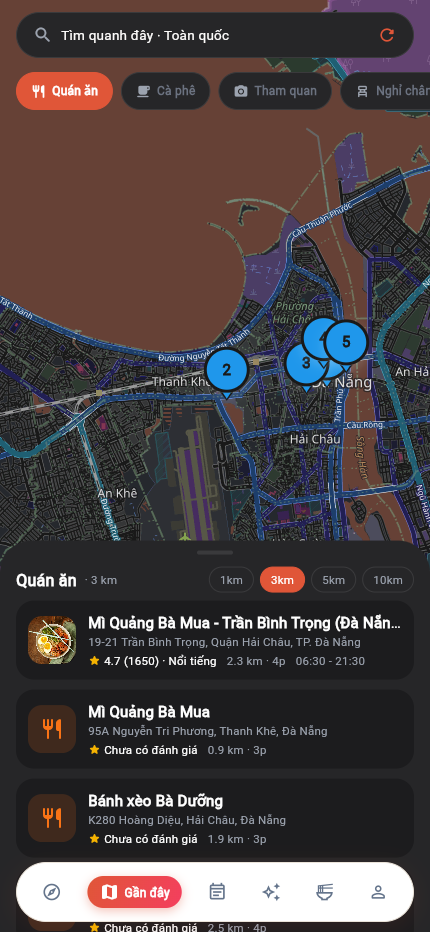
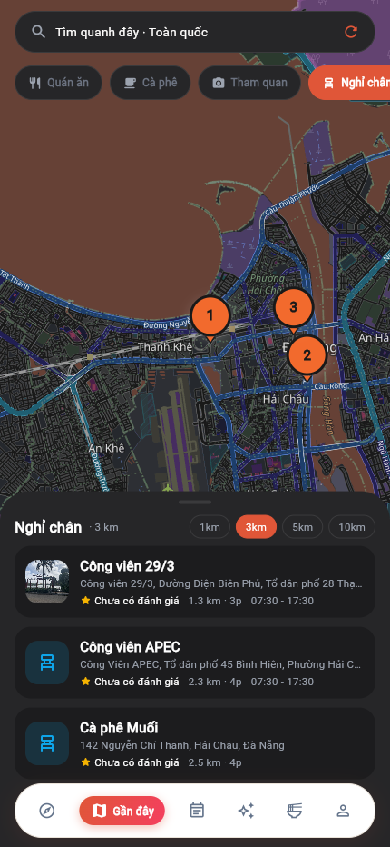
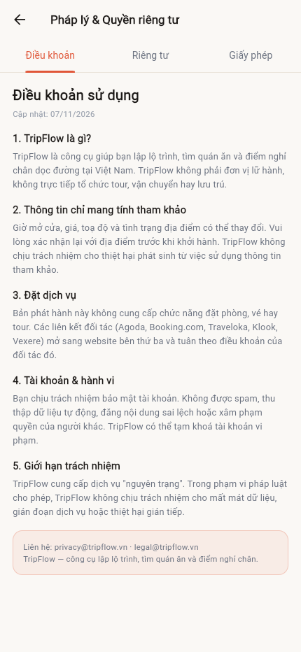

# 10 — Catalog dữ liệu thật (Hà Nội · Đà Nẵng · TP.HCM)

Cập nhật: 06/11/2026

## 1. Mục tiêu

Trước đây app chỉ có 28 địa điểm / 26 quán ăn hard-code trong `mock_data.dart` và seed Python,
phần lớn là dữ liệu biên tập cũ, ảnh không đồng nhất. Đợt này xây một **catalog mở, có kiểm chứng**
cho **10 tỉnh**, trong đó 3 thành phố (Hà Nội, Đà Nẵng, TP.HCM) được phủ sâu nhất, ưu tiên:

- Toạ độ thật (OpenStreetMap Nominatim).
- Mô tả thật (Wikipedia tiếng Việt/Anh).
- Ảnh thật đúng địa điểm (Wikimedia Commons), có **giấy phép + tác giả + link nguồn**.
- Không bịa rating/review khi chưa có nguồn.

## 2. Số liệu hiện tại

| Hạng mục | Giá trị |
|---|---|
| Bản ghi nghiên cứu | **220** (10 tỉnh) |
| Có ảnh hợp lệ | **164** (75%) |
| Địa điểm sau khi seed | **168** |
| Quán ăn / cà phê sau khi seed | **77** (34 quán có ảnh) |
| Điểm nghỉ chân (cây xăng/sạc EV) | **50** (Hà Nội 18, Đà Nẵng 15, TP.HCM 17) |
| Tỉnh/thành có dữ liệu | **10/10** |

Phân bố sau khi seed:

| Thành phố | Địa điểm | Quán ăn/cà phê |
|---|---:|---:|
| Hà Nội | 30 | 17 |
| Đà Nẵng | 24 | 7 |
| TP.HCM | 32 | 23 |
| Quảng Ninh | 12 | 3 |
| Lào Cai (Sa Pa) | 11 | 2 |
| Thừa Thiên Huế | 11 | 6 |
| Quảng Nam (Hội An) | 11 | 6 |
| Khánh Hòa (Nha Trang) | 11 | 4 |
| Lâm Đồng (Đà Lạt) | 13 | 5 |
| Kiên Giang (Phú Quốc) | 13 | 4 |

### Giao diện sau khi nạp catalog









> Một số bản ghi bị bỏ qua khi seed vì trùng tên hoặc nằm trong bán kính 100 m của địa điểm đã có
> (ví dụ "Hồ Hoàn Kiếm" trùng với "Hồ Hoàn Kiếm & Đền Ngọc Sơn"). Bản ghi cũ được bổ sung ảnh mới.

## 3. Nguồn & giấy phép

| Dữ liệu | Nguồn | Ghi chú |
|---|---|---|
| Toạ độ, địa chỉ | OpenStreetMap Nominatim | ODbL; ghi nguồn OSM khi hiển thị bản đồ |
| Mô tả | Wikipedia (vi/en) | CC BY-SA |
| Ảnh | Wikimedia Commons | CC0 / CC BY / CC BY-SA / Public domain |
| Bản đồ nền | OpenStreetMap tiles | Miễn phí, có giới hạn tần suất |

Mỗi bản ghi ảnh lưu:

```json
{
  "url": "https://upload.wikimedia.org/...",
  "thumb_url": "https://.../1280px-....jpg",
  "license": "CC BY-SA 4.0",
  "author": "Tên tác giả",
  "source_url": "https://commons.wikimedia.org/wiki/File:..."
}
```

App hiển thị dòng ghi công ở màn chi tiết địa điểm/quán ăn. **Không được xoá dòng này** khi dùng ảnh CC BY/CC BY-SA.

## 4. Điểm nghỉ chân (cây xăng / sạc EV)

Nguồn: OpenStreetMap qua **Nominatim viewbox** (ổn định hơn Overpass):

- 30 cây xăng Petrolimex/cây xăng địa phương.
- 20 trạm sạc/đại lý VinFast.
- Bảng `rest_stops`; API `/places/nearby?kinds=gas|ev|rest` trả về kèm khoảng cách, thời gian rẽ.
- API `/places/along-route` trả điểm nghỉ **nằm trong hành lang tuyến A → B**, kèm tiến độ trên tuyến.
- Màn Bản đồ lộ trình hiển thị mục “Điểm nghỉ chân dọc tuyến” và cho phép thêm vào lịch trình.
- Chip **“Cây xăng”**, **“Sạc EV”**, **“Nghỉ chân”** trong tab Quanh đây.
- Chưa có ảnh đúng cho các POI này → dùng placeholder trung tính (không ảnh giả).

## 5. Quy tắc chất lượng (đã cài trong code)

1. **Chỉ nhận ảnh khi tiêu đề tệp khớp tên địa điểm**:
   - Với quán ăn/cà phê: bắt buộc có ngữ cảnh (`quán`, `nhà hàng`, `restaurant`, `cafe`, `coffee`...)
     và **toàn bộ** từ khoá riêng của tên quán.
   - Với khách sạn: bắt buộc có `hotel`/`khách sạn`/`resort`.
   - Ảnh bản đồ, logo, PDF, SVG bị loại.
2. **Không có ảnh đúng → để trống** và UI hiển thị placeholder trung tính; tuyệt đối không dùng ảnh món ăn
   chung để giả làm ảnh quán.
3. **Toạ độ phải nằm trong bbox thành phố**; nếu không, bỏ bản ghi.
4. **Không bịa rating/review**: bản ghi mới có `rating = 0`, `reviews_count = 0`; UI hiển thị
   "Chưa có đánh giá" thay vì số ảo.
5. **Chống trùng**: trùng tên hoặc cách < 100 m thì bỏ qua, giữ bản ghi cũ và bổ sung ảnh/mô tả.

## 6. Quy trình thêm dữ liệu

```bash
# 1. Thêm địa điểm vào danh sách biên tập
#    tools/catalog_input.py  →  mục HANOI / DANANG / HCMC
#    (name, city, province_code, type, address/wiki/note)

# 2. Nghiên cứu tự động: OSM + Wikipedia + Commons
python tools/research_catalog.py --city "Hà Nội" --out .tmp/hanoi.json

# 3. Chuẩn hoá + kiểm tra toạ độ/ảnh/giấy phép
python tools/build_catalog.py \
  --inputs .tmp/hanoi.json .tmp/danang.json .tmp/hcm.json \
  --out backend/app/data/catalog_extra.json

# 4. Seed lại DB (idempotent, chỉ thêm bản ghi mới)
cd backend && python -m app.db.seed_db

# 5. Chạy test catalog + toàn bộ backend
python -m pytest -q
```

## 7. Hạn chế còn lại

- **56/220 bản ghi chưa có ảnh đúng** (chủ yếu là quán ăn nhỏ/chuỗi, không có ảnh trên Commons).
  Cách xử lý đúng: cấu hình `GOONG_API_KEY`/Google Places để lấy ảnh địa điểm, hoặc admin upload ảnh
  do đơn vị sở hữu.
- **Chưa có rating/review thật** cho bản ghi mới. Cần Goong/Google Places hoặc để người dùng đánh giá dần.
- **Điểm nghỉ chân** đã có cây xăng/sạc EV cho 3 thành phố lớn; **trạm dừng nghỉ liên tỉnh**
  chưa có (Nominatim không trả kết quả). Cần bổ sung thủ công hoặc nguồn dữ liệu đường cao tốc.
- Một số bản ghi mới trùng chủ đề với seed cũ (ví dụ "Mì Quảng Bà Mua" có 2 chi nhánh);
  cần rà soát thủ công khi mở rộng.
- Ảnh 1280 px (Wikimedia chỉ phục vụ tốt kích thước này); nên thêm cache ảnh/Cloudinary thật khi lưu lượng tăng.

## 8. File liên quan

| File | Vai trò |
|---|---|
| [`tools/catalog_input.py`](../tools/catalog_input.py) | Danh sách biên tập cần nghiên cứu |
| [`tools/research_catalog.py`](../tools/research_catalog.py) | Geocode + Wikipedia + Commons + lọc ảnh |
| [`tools/build_catalog.py`](../tools/build_catalog.py) | Chuẩn hoá, dedupe, xuất JSON |
| [`backend/app/data/catalog_extra.json`](../backend/app/data/catalog_extra.json) | Catalog đã kiểm chứng |
| [`backend/app/db/seed_db.py`](../backend/app/db/seed_db.py) | `_seed_extra_catalog`, `_optimize_media_urls` |
| [`tools/fetch_rest_stops_nominatim.py`](../tools/fetch_rest_stops_nominatim.py) | Lấy cây xăng/sạc EV qua Nominatim viewbox |
| [`backend/app/data/rest_stops_extra.json`](../backend/app/data/rest_stops_extra.json) | 50 điểm nghỉ chân đã kiểm chứng |
| [`backend/app/models/rest_stop.py`](../backend/app/models/rest_stop.py) | Model `rest_stops` |
| [`backend/tests/test_catalog.py`](../backend/tests/test_catalog.py) | Test toàn vẹn toạ độ/ảnh/giấy phép |
